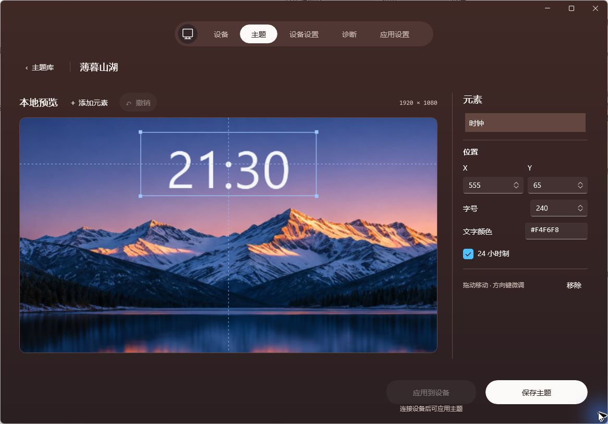

# USB Display

Windows USB 显示屏上位机。编辑和预览主题、显示实时监测数据，并管理设备设置。

[正式版下载](https://github.com/iamshen/USBDisplayHost/releases/latest) · [Beta 6 下载](https://github.com/iamshen/USBDisplayHost/releases/tag/0.2.0-beta.6) · [反馈问题](https://github.com/iamshen/USBDisplayHost/issues)

