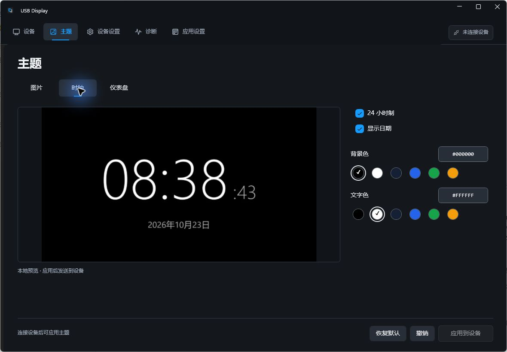
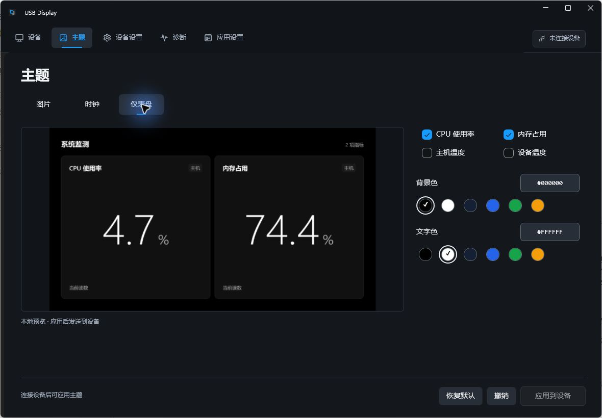
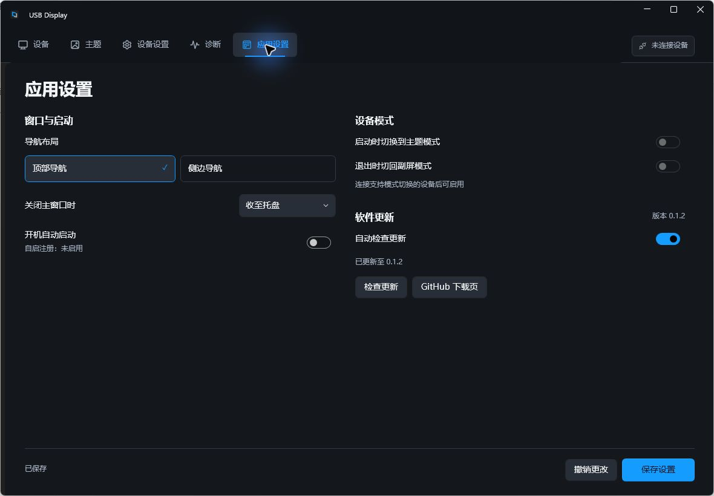

# USB Display

Windows 原生 USB 屏上位机。编辑主题，预览内容，管理设备。

**[下载 Windows x64](https://github.com/iamshen/USBDisplayHost/releases/latest/download/USBDisplayHost-win-x64-Setup.exe)** · [版本记录](https://github.com/iamshen/USBDisplayHost/releases) · [安装说明](docs/release/offline-installation.md)

<br>



<br>

## 功能

- **主题编辑** — 图片、时钟和仪表盘，先在本地预览，再应用到设备。
- **设备管理** — 连接与状态查看、亮度与显示参数、主题／副屏模式切换。
- **日常使用** — 托盘驻留、本地诊断、GitHub 版本检查与应用内下载更新。

面向 AD102 / AD102 V2 当前固件的 1920 × 1080 屏幕，设备功能取决于固件能力与驱动。

<details>
<summary>查看更多界面</summary>

仪表盘 · 本机 CPU 与内存指标



应用设置 · 更新完成后的版本状态



以上为无设备环境下的实际应用截图。

</details>

## 安装与更新

下载并运行 `USBDisplayHost-win-x64-Setup.exe`。安装包包含 .NET 与 WPF 运行时，无需额外安装 SDK；设备驱动按厂商说明配置。

后续在「应用设置 → 软件更新」检查并下载新版，确认后退出应用、重启安装。若 v0.1.1 无法启动，请直接运行最新版安装包；手动安装前，先从托盘菜单退出旧实例。

配置、素材和日志保存在 `%LocalAppData%\UsbDisplayHost.Data`。

当前为未签名的早期版本。v0.1.2 已完成本机无设备安装、应用内升级与重启验证；真实设备兼容性及会话关闭仍待实物验证。[查看验证记录 →](docs/verification/upgrade-v0.1.2-2026-10-23.md)

## 开发

使用 Windows 与 .NET SDK **10.0.401**，版本由 `global.json` 锁定。界面基于 WPF、WPF UI 和 CommunityToolkit.Mvvm。

在仓库根目录执行：

```powershell
./build.ps1 -Action Build
./build.ps1 -Action Package
```

安装包输出到 `.artifacts/installers/win-x64/<Version>/`。构建与打包不会启动应用。

无设备查看界面：

```powershell
dotnet run --project src/UsbDisplayHost.Desktop -- --ui-only
```

`--ui-only` 不连接 USB 设备，应用偏好、素材和日志仍使用当前用户的数据目录。

代码按 `Core`（业务模型）、`Windows`（系统与设备适配）、`Rendering`（离屏绘图）、`Desktop`（界面）组织，均位于 [`src/`](src/)。

推送 `main` 自动打包；推送与项目版本一致的 `vX.Y.Z` 标签自动发布 GitHub Release。详见 [发布与更新说明](docs/release/github-release.md)。

## 问题反馈

遇到问题时，请[提交 Issue](https://github.com/iamshen/USBDisplayHost/issues/new)，提供应用版本、设备型号、复现步骤、预期与实际结果，以及已去除敏感信息的日志。

## 文档

- [产品需求](docs/02_PRD.md) · [软件架构](docs/03_软件技术架构.md)
- [界面规范](docs/06_UI设计规范.md) · [配置与自动恢复](docs/07_配置与自动恢复.md)
- [设备与协议](docs/contracts/) · [验证记录](docs/verification/)
- [开发规范](docs/05_项目规范.md) · [实施任务](openspec/changes/build-usb-display-host-v1/tasks.md)
