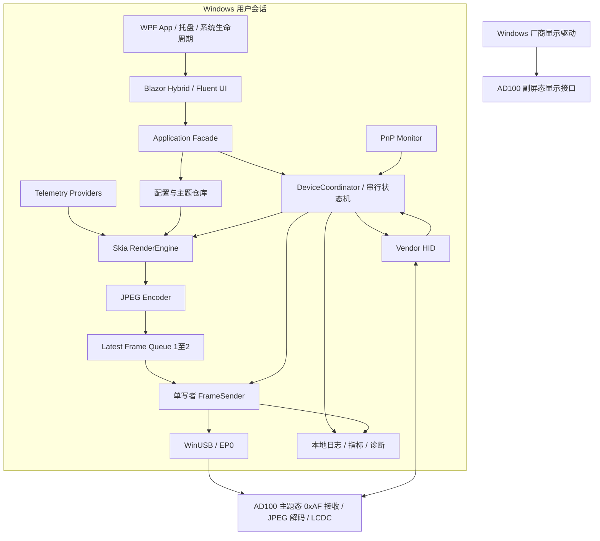
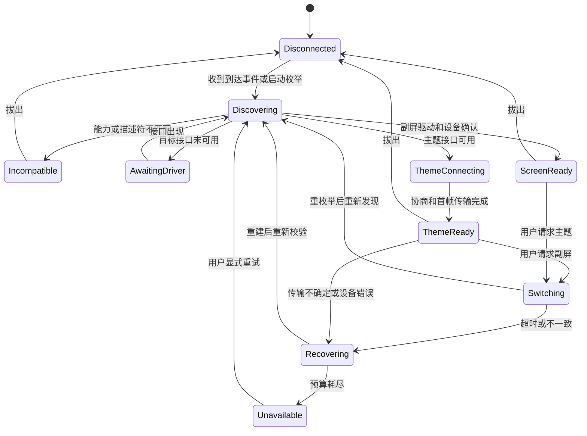

# USB Display 上位机｜软件技术架构

版本：v0.1 评审稿　日期：2026-10-06　暂定工程名：UsbDisplayHost

## 1. 架构结论

**建议基线：.NET 10 LTS + WPF 宿主 + Blazor Hybrid + Fluent UI Blazor；SkiaSharp 离屏渲染 + libjpeg-turbo 编码；Windows WinUSB/HID 后端；Stateless + 单设备串行事件处理；JSON 配置 + Serilog + 本地指标；Azure DevOps Server 持续集成。**

这是针对 Windows 上位机的选型，不是把附件中的 C/libusb/hidapi 示例逐行移植，也不是用户此前已为本 USB 项目批准的技术方案。S1/S2 的协议字段仍是原始依据，修订点必须按《01_需求分析》的 ISS 清单显式评审。

首版是本地模块化程序，不依赖 Kestrel、SignalR、Dapr sidecar、Actor 集群、Kafka、Redis、PostgreSQL、Kubernetes 或登录服务。设备不接互联网时也应可用。应用层可区分 Command/Query，但不建立 Event Store，也不使用分布式锁控制本机 USB 句柄。

## 2. 技术基线与备选取舍

| 边界 | 首选 | 选择理由 / 注意事项 |
|---|---|---|
| 运行时 | .NET 10 LTS | 沿用你的 C# 能力，避免新项目刚上线即面临 .NET 9 支持结束 |
| IDE / 构建 | 支持 net10.0 的 Visual Studio 18.0+；dotnet CLI | 不能默认 VS2022 完整支持 net10.0；SDK 和 Agent 同步锁定 [W1][W2] |
| 目标平台 | Windows 11 x64（建议首发矩阵） | 与附件 Windows 驱动方案一致；不提前承诺其他 OS / ARM64 |
| 桌面宿主 | WPF | 负责窗口、托盘、系统生命周期；不承载业务状态 |
| 管理 UI | BlazorWebView + Fluent UI Blazor | 保留现有 Razor/Fluent 能力，不另引入第二套 UI 库 [W3][W4] |
| 状态机 | Stateless | 每个设备实例只由单一调度器触发，不能多线程并发 Fire [W5] |
| USB | WinUSB API 的薄 C# 封装 | 与 Windows 目标匹配；避免首版再维护 libusb 适配层 |
| HID | Windows HID API 的薄 C# 封装 | 按 collection、capabilities、报告长度工作 [W6] |
| 热插拔 | CM_Register_Notification + 接口枚举 | 回调轻量、先注册后枚举、去重对账 [W7] |
| 合成 | SkiaSharp | 统一逻辑画布、预览与物理帧；离屏不依赖管理窗口显示 |
| JPEG | libjpeg-turbo 受控 native 封装 | 显式控制 baseline、采样、质量；与 Skia 解耦 [W8] |
| PC 采集 | provider 抽象；LibreHardwareMonitor 为候选 | 不假设 WMI 可提供所有 CPU 温度，按具体库和硬件验收 [W9] |
| 配置 | System.Text.Json、本地文件、原子替换 | 当前没有必须引入数据库的业务关系 |
| 日志/指标 | Serilog + ActivitySource/Meter | 继承现有观测习惯；默认本地、可选显式启用 OTLP |
| 发布 | 签名安装包、版本清单、Windows 自建 Agent | 固件/驱动/应用分别版本化，硬件测试不在普通 CI 中假通过 |

.NET 10 官方支持截止日期为 2028-11-14；.NET 9 为 2026-11-10，核验日期 2026-10-06。[W1] 不在本文指定未经验证的最新 NuGet patch：G0 后在 global.json、Directory.Packages.props、packages.lock.json 中冻结实际通过验证的版本。

### 2.1 为什么不直接选 MAUI 或纯 WPF 控件

MAUI 是可行候选，但本项目没有已确认的跨平台需求，最困难的部分本就依赖 Windows 驱动/PnP。先用 WPF 宿主可收窄平台面；Razor UI 可保留未来复用机会。纯 WPF 也可实现，但会失去现有 Fluent UI Blazor 的直接复用，故不作为当前主案。

这是一项架构决策而非永久约束；若团队明确要求 MAUI，应通过 ADR 更换 App 宿主，保持 Application、Protocol 与 Rendering 不受 UI 选择影响。

### 2.2 为什么不把管理页面截图后推屏

管理 UI 的 DPI、窗口尺寸、WebView 布局和生命周期不应决定物理屏像素。屏幕画面使用独立 RenderDocument → raster → JPEG 管线。窗口隐藏、托盘运行、窗口缩放时，设备输出仍保持确认的物理尺寸。

## 3. 系统总图



两态复用同一物理显示接口，但由不同驱动控制。HID 解决两态控制可达性，不意味着切换过程中句柄始终有效。原生副屏态上位机不打开或抢占 MI_00。[S2 §1.3、§2、§3]

## 4. 进程与权限模型

### 4.1 默认单进程

主程序位于交互式用户会话，负责托盘、UI、控制、渲染、发送与基础采集。优先保持部署简单；模块隔离依靠接口、所有权和测试，而非先拆服务。

对某些硬件传感器，LibreHardwareMonitor 官方说明可能需要管理员权限。[W9] 不能据此将带 WebView 和图片导入能力的整个主程序长期提升为管理员。

### 4.2 可选特权采集进程

当正式支持列表确需特权时，再增加 `TelemetryCollector` 独立组件。职责仅限白名单只读采集，经受限 Named Pipe 返回指标；校验调用方、协议版本、报文长度及请求频率。不提供任意设备寄存器写入、任意 DLL 路径或执行命令接口。

用户拒绝该组件时显示指标不可用，壁纸、时钟和 USB 显示仍可工作。安装权限与运行权限分开，不要求用户降低系统安全配置。

### 4.3 多实例与会话占用

单用户 UI 使用命名互斥量与 IPC 激活已有窗口；设备控制另有跨会话的受保护占用检测。检测其他 Windows 用户会话占用时报告忙碌，不终止对方进程、不抢句柄。首版不支持一设备同时被两个应用实例控制。

## 5. 解决方案结构与依赖

```text
UsbDisplayHost/
  global.json
  Directory.Build.props
  Directory.Packages.props
  .editorconfig
  src/
    UsbDisplayHost.App/                 WPF宿主、托盘、依赖组装
    UsbDisplayHost.Ui/                  Razor组件、Fluent主题、视图状态
    UsbDisplayHost.Core/                身份、能力、值对象、端口接口
    UsbDisplayHost.Application/         用例、状态机、会话编排
    UsbDisplayHost.Protocol/            纯0xAF/EP0/HID编解码与验证
    UsbDisplayHost.Platform.Windows/    WinUSB、HID、PnP、原生句柄
    UsbDisplayHost.Rendering/           Skia、画布变换、JPEG适配
    UsbDisplayHost.Infrastructure/      配置、采集Provider、日志、诊断
  tests/
    UsbDisplayHost.Protocol.Tests/
    UsbDisplayHost.Application.Tests/
    UsbDisplayHost.Rendering.Tests/
    UsbDisplayHost.Architecture.Tests/
    UsbDisplayHost.Hardware.Tests/      显式需要测试设备
  tools/
    UsbDisplayHost.ProtocolProbe/       只读诊断和受控测试帧工具
  assets/themes/
  docs/adr/
  docs/protocol/
  pipelines/
```

Core/Protocol 可以采用 `net10.0`；App 与 Windows 后端采用 Windows TFM，例如 `net10.0-windows10.0.19041.0`。TFM 的最低 API 版本不是产品承诺支持所有 Windows 10 版本。

依赖方向：Ui → Application → Core；Protocol → Core（或纯独立）；Platform.Windows、Rendering、Infrastructure 实现 Core 中的端口；App 作为 composition root 引用并组装。Application 不引用 WPF、Blazor、Win32、Skia、文件路径或具体传感器库。可以合并小项目，但不能反转边界。

## 6. 核心对象与持久化边界

| 对象 | 关键字段 | 生命周期 |
|---|---|---|
| DeviceIdentity | VendorId、稳定 Serial、Model、HardwareRevision | 设备身份；PID 不作为身份主键 |
| DeviceEndpointSet | 当前路径、InterfaceNumber、AltSetting、BulkOut、HID collection、ContainerId | 每次枚举产生，不能长期保存 |
| DeviceCapabilities | 协议版本、NativeSize、最大帧/传输、模式/命令能力、固件版本 | 每个会话重新读取或匹配验证档 |
| DeviceSession | Identity、SessionEpoch、连接、取消源、运行模式 | 仅内存；句柄不持久化 |
| ModeTransition | OperationId、源/目标模式、阶段、期限、观测结果 | 内存 + 诊断摘要，不当作重启真值 |
| DisplayProfile | DeviceKey、亮度期望、方向、目标帧率、质量、退出策略 | 每设备配置 |
| ThemeDefinition | schemaVersion、模板类型、素材引用、布局参数、metric bindings | 本地数据，不能包含可执行代码 |
| TelemetrySample | MetricId、Source、Unit、Value?、Quality、CapturedAt | 有界快照/短历史，不默认落全量时序库 |
| FrameEnvelope | SessionEpoch、LocalFrameId、RenderedAt、尺寸、JPEG owner | 生命周期由队列/发送者负责 |
| DeviceRuntimeSnapshot | 连接/模式/运行状态、参数确认情况、错误摘要 | 不可变快照供 UI 查询 |

`SessionEpoch` 与 `LocalFrameId` 是本地隔离标记，**不得擅自塞入现有 0xAF 帧头**。新会话拒绝旧 epoch 的帧、回调和异步结果。

建议存储于 `%LocalAppData%/UsbDisplayHost/`，分为 config、profiles、themes、logs、diagnostics。写配置时临时文件与目标同目录，验证完成再原子替换。没有订单/商户等业务关系，当前不引入 EF Core 或 SQLite。将来出现需要事务的本地主题资产索引再作 ADR。

## 7. 状态机与并发规则

### 7.1 总状态



ThemeReady 内部还要区分 Streaming、StaticHeld、Paused、ScreenOff。图中未展开的任一状态均须处理进程退出、设备移除和取消，不得只为“主路径”编程。

### 7.2 单一状态写者

采用 DeviceCoordinator 作为进程内设备协调器。每台设备的控制事件串行进入状态机；UI、HID、PnP、定时器不能直接改状态或同时调用 Stateless。Stateless 的异步 API 不等于线程安全。[W5]

控制命令使用有界队列并可向 UI 返回 Busy；不可像视频帧一样丢弃。PnP 回调只复制信息、更新待处理生命周期信号并唤醒协调器，不能阻塞等待 I/O。生命周期信号需去重和对账，队列满不能静默丢掉设备移除；移除可立即取消 native I/O，再在协调器中完成状态变更。[W7]

**避免邮箱自等待：**状态处理器不能等待只有同一邮箱消费后才能完成的“重枚举事件”。开始异步副作用后返回，副作用完成再投递带 OperationId/Epoch 的结果事件。所有任务均被统一跟踪和回收，禁止 async void 或无所属的后台任务。

### 7.3 图像与控制两条调度通道

图像队列深度 1～2，采用最新完整帧优先；丢弃回调必须释放被替换的 pooled buffer。[W10] 控制队列不丢命令，过载时返回明确错误。

每台设备只保留一个 Bulk 写者。一个 JPEG 帧开始发送后，正常情况下按序发完所有分片，期间不插入下一帧。通过 Bulk 发送的控制指令也在已完成帧边界执行；HID 逻辑独立，但模式、复位、熄屏等改变会话的命令必须经过协调器先停管线。

## 8. Windows 传输适配

### 8.1 设备发现

先注册接口到达通知，再枚举现存接口，按设备身份和接口路径去重；随后注册移除相关通知。这样覆盖启动前已插入设备和注册/枚举之间的竞态。[W7]

主题态按专用设备接口 GUID 找 WinUSB 路径；HID 按序列号、UsagePage/Usage、collection 与报告能力定位。PID 过滤只用于候选集，不能取代身份识别。接口号、alternate setting 和端点地址从实际描述符读取；MI_00 是固件设计约束，不是允许上位机硬编码 endpoint=0x01 的理由。[S1 B1；S2 §4.1]

libusb 作为未来跨平台 backend 可保留接口扩展点。若选择它，必须锁定版本、构建和 `LIBUSB_CAP_HAS_HOTPLUG` 等能力；libusb 1.0.30 已增加 Windows hotplug，不能用过时结论做设计。[W11]

### 8.2 WinUSB 句柄与取消

P/Invoke 限于 Platform.Windows，使用 SafeHandle 封装文件与 WinUSB interface handle。写入采用有明确生命周期的 overlapped I/O 或专用受控 I/O 执行器，不能简单用 Task.Run 包装无限等待的同步写入冒充可取消。

取消后只有在 native I/O 确认完成或终止后才能归还被固定/引用的内存、释放 OVERLAPPED、关闭事件与句柄。`CancellationToken` 已取消不等于 DMA/驱动已停止访问 buffer。

使用三个不同层面的恢复动作：取消/Abort 当前主机 I/O、必要时清 pipe stall、按固件契约重置 parser/会话。`WinUsb_ResetPipe` 不能被当作设备 JPEG 拼帧状态清理；EP0 SOFT_RESET 也不能未经验证就承担全部恢复职责。

### 8.3 传输限额与短包

定义：

```text
TransferBudget = min(240 * 1024,
                     device.maxTransfer,
                     WinUSB.MAXIMUM_TRANSFER_SIZE)
PayloadBudget = TransferBudget - 11
MaxJpegBytes = 经确认能力中的上限；当前已知基线为 1 * 1024 * 1024
```

能力缺失只能使用经过验证的固件配置档，不随意猜测大值。每片必须包含完整头和 payload；禁止写到 buffer 容量而非实际有效长度。

候选传输策略：一个 0xAF 记录一次 WritePipe；配置 OUT `SHORT_PACKET_TERMINATE=true`，让整数倍端点最大包长的写入追加 ZLP，非整数倍写入自然短包结束。该策略必须通过固件对 ZLP、接收请求完成和残留解析的联合验证后冻结，不是“设置后必然正确”。WinUSB 官方明确该策略默认关闭。[W12]

禁止随意加 padding 凑 512、误把 RAW_IO 的读取限制应用到写入、依赖一次应用写入必然等于一次设备解析缓冲。固件最好对协议字节流边界具有健壮性；至少必须证明所选发送策略与当前 parser 一致。

### 8.4 EP0 请求

| 项目 | 暂按源文的请求 | 约束 |
|---|---|---|
| GET_STATUS | bmRequestType=0xC1，bRequest=0x01 | 精确读取 1B；0x18 正常，位图扩展规则待固件冻结 |
| GET_EDID | 0xC1 / 0x02，wValue=offset | 校验返回长度、校验和及分块行为 |
| SOFT_RESET | 0xC1 / 0x03 | 无数据；复位范围必须明确，不等于系统重启 |
| GET_BACKLIGHT | 0xC1 / 0x04 | 精确读取 1B，值域0～100 |
| specific descriptor | 0x81 / 0x06，wValue=0x1F00 | 校验完整长度和每个子项边界 |

wIndex 使用发现的 display interface number。原文 class/vendor 混写问题单独处理：class/interface IN 的请求类型应是 0xA1，但在未核验固件前不改变上述 vendor 请求。[S1 B7；W13]

启动协商完整顺序保持源文：COLOR_FORMAT → WIDTH_HIGH → WIDTH_LOW → HEIGHT_HIGH → HEIGHT_LOW → BACKLIGHT → AUTORLX(0) → MJPEG(1) → BLANK_MODE(ON)。任一发送失败立即中止，不继续“凑齐后面的命令”。[S1 B4.1]

## 9. 0xAF 编码与正确分片

### 9.1 不变式

所有 24bit 长度/偏移为大端。`0x68` 头 8B，`0x69` 头 11B；MJPEG 整帧 pixel_offset=0。offset 从零开始严格连续，只有最后一片为 0x69，总 payload 必须恰好等于编码后的 JPEG 长度。[S1 B3～B5]

`0x20` 命令的 val 仅一字节。未来待机时间若超过 255 秒、复杂配置或文件长度，必须定义版本化扩展，不允许截断或复用未确认字段。

### 9.2 参考分片算法（C#，非完整驱动）

以下仅是字节封包参考：故意采用独立数组便于审计；生产路径改为池化时必须保留全部不变式。调用前须经 JPEG 验证器确认完整 baseline、采样和尺寸，下面的 SOI/EOI 检查不能替代解码结构验证。

```csharp
using System;
using System.Collections.Generic;

public static class AfJpegPacketizer
{
    public const int MaxJpegBytes = 1 << 20;
    public const int DefaultTransferBudget = 240 * 1024;

    public static IReadOnlyList<ReadOnlyMemory<byte>> PacketizeValidatedJpeg(
        ReadOnlyMemory<byte> jpeg,
        int transferBudget = DefaultTransferBudget)
    {
        if (jpeg.Length < 4 || jpeg.Length > MaxJpegBytes)
            throw new ArgumentOutOfRangeException(nameof(jpeg));
        if (transferBudget <= 11 || transferBudget > DefaultTransferBudget)
            throw new ArgumentOutOfRangeException(nameof(transferBudget));

        var source = jpeg.Span;
        if (source[0] != 0xFF || source[1] != 0xD8 ||
            source[^2] != 0xFF || source[^1] != 0xD9)
            throw new ArgumentException("JPEG markers are invalid.", nameof(jpeg));

        var packets = new List<ReadOnlyMemory<byte>>();
        int offset = 0;
        int payloadBudget = transferBudget - 11;
        while (offset < source.Length)
        {
            int count = Math.Min(source.Length - offset, payloadBudget);
            bool isLast = offset + count == source.Length;
            int headerLength = isLast ? 11 : 8;
            var packet = new byte[checked(headerLength + count)];

            packet[0] = 0xAF;
            packet[1] = isLast ? (byte)0x69 : (byte)0x68;
            WriteUInt24BigEndian(packet.AsSpan(2, 3), offset);
            WriteUInt24BigEndian(packet.AsSpan(5, 3), count);
            // 最后片的 [8..11) 为 pixel_offset，new byte[] 已初始化为 0。
            source.Slice(offset, count).CopyTo(packet.AsSpan(headerLength));
            packets.Add(packet);
            offset = checked(offset + count);
        }
        return packets;
    }

    private static void WriteUInt24BigEndian(Span<byte> target, int value)
    {
        if (target.Length < 3 || (uint)value > 0x00FF_FFFFu)
            throw new ArgumentOutOfRangeException(nameof(value));
        target[0] = (byte)(value >> 16);
        target[1] = (byte)(value >> 8);
        target[2] = (byte)value;
    }
}
```

与原文区别：先确定 payload，再由同一个 `isLast` 同时决定 type 和头长，消除 ISS-03。此参考没有执行 C# 编译或实机测试；已执行的是需求分析中注明的独立 Python 算术遍历。

### 9.3 必须进入回归集的边界

`C=245760` 时至少覆盖 `C−12`、`C−11`、`C−10`、`C−1`、`C`、`C+1`、两倍阈值附近、1MiB、1MiB+1；另测有效记录长度为 512、1024 和非整数倍的短包/ZLP 行为。

测试分两类：纯算法可以使用任意长度字节序列验证头和重组；真 JPEG 测试必须使用结构合法且尺寸正确的图片，不能把随机 bytes 包上 FF D8/FF D9 视为合法 JPEG。

### 9.4 不确定写入的处理

完整帧未开始时可丢弃或替换；一旦有分片进入 USB，发生短写/超时/取消后不重发余下片，也不直接紧接下一帧。返回 `SessionSyncUnknown`，使协调器停止发送并按经过验证的 parser-reset 契约恢复。恢复后从 offset=0 发新的完整 JPEG。

原因：主机传输结果不能充分说明设备已消费哪些字节；不能基于返回字节数实现“断点续传 JPEG”。新帧可能触发新块分配，但也不能据此保证残留解析已经干净。[S1 B5/B8；ISS-09]

## 10. HID 与命令契约

### 10.1 已有来源与新增建议分开

源文提出 Input ID 1、Output ID 2、Feature ID 3。Input 的头部字段包括状态、背光、温度、FPS、计数和固件版本；这不代表固件已经实现这些 report。[S2 §4.5]

本项目建议补齐下列字段集合，但**本文不把它们当成已冻结字节偏移**：

| 契约 | 必需信息 | 冻结责任 |
|---|---|---|
| Capabilities | magic/协议版本、硬件/固件版本、稳定身份、模式与命令能力、native尺寸、最大帧/传输 | 固件 + Host |
| Command | RequestId、命令号、目标值/参数、协议版本、长度 | 固件 + Host |
| Ack/Result | 对应 RequestId、命令号、Accepted/Applied/Rejected、错误码 | 固件 + Host |
| Telemetry | 指标单位、有效性、采样时间或周期、计数口径、溢出规则 | 固件 + Host |
| Touch | 独立报告/collection、坐标范围、接触ID与状态、方向和时间 | 固件 + Host |

建议优先保留已存在字段布局，为扩展协商独立版本；新增 ACK 或 touch report 必须选择经评审的 ID，并更新 HID report descriptor 与 golden vectors。未支持扩展的固件不能收到凭空添加的字段。

### 10.2 操作与回执

模式使用 `SetMode(Theme/Screen)` 而非 Toggle；设置类指令尽量幂等。一次操作拥有本地 OperationId；若 wire 协议支持 RequestId，则建立映射。没有该能力时不能模拟出设备 ACK。

模式切换可在旧 HID 上收到 Accepted 后立即失联，最终成功以重新枚举和目标功能就绪确认；不要求旧句柄收到 Applied。HID 输出成功只是主机 I/O 结果。

禁止直接复制 S1 C3 中 `AF 20 30 01` 作为切换命令，统一待审注册表使用 S2 §3.8 的 `0x31`；G0 核实后方可编码。纯熄屏 `0x36`、心跳 `0x38` 等均按能力启用，不假设 `0x30+` 永久无冲突。

## 11. 双模切换的正确时序

### 11.1 副屏 → 主题

1. 确认当前真实模式是 Screen、目标设备匹配、HID 和切换能力可用。
2. 创建唯一 OperationId，进入 Switching，禁止并发切换。
3. HID 提交绝对目标 Theme；受支持时记录 Accepted。
4. 旧设备移除时关闭旧 HID/相关句柄；保留身份，不复用路径。
5. 等待同身份主题态接口出现；驱动准备与普通超时分别处理。
6. 重新打开 vendor HID/WinUSB，读取并校验描述符与能力。
7. 发送完整协商，发送首帧；依据反馈口径更新 ThemeReady 与呈现状态。

### 11.2 主题 → 副屏（对原文时序的显式修订）

1. 进入 Switching，禁止新主题/新帧。
2. 停止渲染调度，丢弃未发送帧；在期限内完成当前帧，或取消当前 I/O。
3. 等待 native I/O 完结后释放 WinUSB；若取消导致 parser 不确定，按已确认的切换/复位契约处理，不能忽略。
4. 使用此时仍有效的 HID 发送目标 Screen。
5. 旧 HID 消失后关闭，等待同身份 AD11 重新出现。
6. 验证厂商驱动、HID 与 Windows 对应显示目标，进入 ScreenReady。

若步骤 4 失败且设备仍在主题态，重新发现并建立新主题会话，不在旧句柄上恢复发送。任何失败都从实际设备状态重建，不能仅复原内存枚举值。

### 11.3 时限与补偿

普通已装驱动场景以原文 8s 为目标；首次驱动准备单列状态和可配置 60s 上限（建议）。补偿最多一次且必须确认当前可达通道；无法恢复时明确 Unavailable。驱动缺失不会被多次 PID 切换修好。

## 12. 渲染与 JPEG 编码

### 12.1 统一坐标系

配置档提供 PhysicalWidth/Height；主题有 LogicalCanvas。方向0/180与90/270分别选择逻辑宽高，再通过统一矩阵映射到物理帧。最终输出按固件确认尺寸编码，不能因为 UI 是横屏就交换协议宽高。

模板、字体测量、布局、缩放/裁切和背景填充只在 RenderEngine 中完成。预览复用 RenderDocument/同源位图，可降低预览刷新率与分辨率，但必须保留相同布局变换。设备变成触摸屏后，命中测试使用相同矩阵的逆变换，并对 letterbox 区域做边界判断。

### 12.2 编码契约

baseline JPEG、完整 SOI/EOI、确认的尺寸、4:2:0、质量默认80；常规70～85，AUTORLX=0。[S2 §5.3；S1 B6] 编码器封装应输出质量、采样、宽高和帧字节数元信息，并用 JPEG 解析器核验 SOF 类型/尺寸/采样；不能只验证起止标记。

过大帧的候选策略是 80→75→70，最多三次编码，仍超1MiB就拒绝当前内容并提示；不无限循环，不截断，不改像素尺寸。其他起始质量按不升高质量的方向降级，最低值由测试档控制。

COLOR_FORMAT 的 RGB565 主要约束相关显示/rlx缓冲，不代表 JPEG 自动减半。以实际编码输出衡量带宽。[S1 §7、B4；ISS-12]

### 12.3 缓冲与资源预算

1080×2400×4＝10,368,000B，约9.89MiB，一帧物理 BGRA buffer 就接近10MiB。两份 raster 加至多两份 JPEG/在途分片，再加 Skia/native/WebView 子进程，不应仅观察托管堆。

使用明确 OwnedFrame / IMemoryOwner 语义。队列满被丢弃、编码失败、取消、设备切换、正常发送结束均要归还资源。Skia 对象与 native 编码器实例不得跨线程无保护复用。性能目标按进程树、native内存、池化buffer数量共同验收。

## 13. 背压、帧率与反馈

USB 有传输层 ACK/NAK；当前没有足以直接证明 LCD 呈现的应用级反馈。[W14] 因此采用两层控制：主机端有界最新帧队列保持低延迟；基于发送耗时、短写/超时、可选设备计数调整负载。

在成功重建并恢复同步后，连续2次相关超时可把目标帧率减半至最低1fps；稳定32帧后有限提升，最多配置上限。这沿用原文参数作为候选，必须加滞后和冷却窗口，避免频繁震荡。[S2 §1.5]

**降帧不能代替重同步。**发生部分写入不确定时先停管线恢复；不能一边降低帧率一边继续污染 parser。保持静态时无须发送重复 JPEG；HID/EP0 的健康检查独立于图像频率。

## 14. 可观测性与错误模型

建议统一返回 `OperationResult<T>`：Code、UserMessage、OperationId、Retryable、DetailsRef。原生错误码、堆栈与路径进日志，不直接绑定 Toast。

| 指标/事件 | 含义 |
|---|---|
| render.duration / jpeg.encode.duration | 合成与编码耗时 |
| frame.bytes | 实际JPEG字节 |
| frame.dropped_before_send | 主机替换旧待发帧 |
| usb.write.duration / bytes / timeout / short_write | 传输结果，不是呈现结果 |
| device.decoded / device.presented | 只有语义已确认且固件回传时才记录 |
| mode.transition.duration | 按源/目标/阶段分解 |
| session.recovery / hid.reopen / pnp.reconcile | 稳定性与恢复 |
| telemetry.sample_age / unavailable | 数据质量 |

日志公共字段包括 AppVersion、ProtocolProfile、固件/驱动版本、脱敏DeviceKey、SessionEpoch、OperationId、Mode、State。高频正常路径按5s摘要或采样记录，错误保留事件。离线默认不创建远程 exporter；诊断包由用户主动导出。

## 15. 测试与交付架构

纯测试：Protocol 编解码、字段范围、长度模糊输入；状态机通过 FakeTransport/FakePnP/TimeProvider 覆盖超时与重枚举；Rendering 用固定主题和 golden image；Architecture tests 验证依赖方向。

实机测试：独立 Windows Agent + 标记样机 + 固定驱动/固件，记录控制器与线材。模拟器成功只能证明 Host 对模拟契约工作，不能替代 parser/ZLP、JPEG硬解、双PID驱动和屏幕结果。

发布采用已签名版本化包、受控 native DLL、第三方许可清单与 SBOM。应用更新、驱动更新、固件升级分别授权和执行。R1 暂不实现设备 OTA，不复用画面发送队列传固件。

## 16. ADR 清单

| ADR | 当前决策（待评审） | 重新评估条件 |
|---|---|---|
| ADR-001 | .NET 10 LTS | SDK/依赖兼容阻塞或生命周期变化 |
| ADR-002 | WPF + Blazor Hybrid + Fluent | 跨平台成为明确需求 |
| ADR-003 | Windows原生传输后端 | 确认支持Linux/macOS且供应商驱动可用 |
| ADR-004 | 单设备协调器、无Dapr/ES | 出现跨机协同业务而非本机USB性能问题 |
| ADR-005 | 整帧MJPEG、首版rlx关闭 | 已有测量证明带宽/延迟成为瓶颈 |
| ADR-006 | JSON本地配置 | 出现必须事务化的复杂资产关系 |
| ADR-007 | 两PID重枚举、HID控制 | 固件/驱动提出经验证的不同绑定架构 |
| ADR-008 | 特权采集可选隔离 | 支持列表必须使用特权且完成安全评审 |
| ADR-009 | 一记录一Write、ZLP策略 | 联合抓包发现与固件request边界不兼容 |
| ADR-010 | 无反馈不报告呈现成功 | 新固件提供已定义的Presented计数/回执 |

## 参考资料

S1/S2 原文与冲突编号见《01_需求分析》。

- [W1 .NET Support Policy](https://dotnet.microsoft.com/en-us/platform/support/policy)
- [W2 SDK / MSBuild / Visual Studio 支持矩阵](https://learn.microsoft.com/en-us/dotnet/core/porting/versioning-sdk-msbuild-vs)
- [W3 WPF Blazor Hybrid](https://learn.microsoft.com/en-us/aspnet/core/blazor/hybrid/tutorials/wpf?view=aspnetcore-10.0)
- [W4 Fluent UI Blazor Hybrid](https://fluentui-blazor.azurewebsites.net/BlazorHybrid)
- [W5 Stateless：异步与单线程约束](https://github.com/dotnet-state-machine/stateless)
- [W6 HIDP_CAPS](https://learn.microsoft.com/en-us/windows-hardware/drivers/ddi/hidpi/ns-hidpi-_hidp_caps)
- [W7 CM_Register_Notification](https://learn.microsoft.com/en-us/windows/win32/api/cfgmgr32/nf-cfgmgr32-cm_register_notification)
- [W8 libjpeg-turbo 官方仓库](https://github.com/libjpeg-turbo/libjpeg-turbo)
- [W9 LibreHardwareMonitor：权限与使用](https://github.com/LibreHardwareMonitor/LibreHardwareMonitor)
- [W10 .NET Channels 与 itemDropped](https://learn.microsoft.com/en-us/dotnet/core/extensions/channels)
- [W11 libusb 1.0.30 ChangeLog](https://github.com/libusb/libusb/blob/v1.0.30/ChangeLog)
- [W12 WinUSB Pipe Policies](https://learn.microsoft.com/en-us/windows-hardware/drivers/usbcon/winusb-functions-for-pipe-policy-modification)
- [W13 USB setup 位定义](https://learn.microsoft.com/en-us/openspecs/windows_protocols/ms-xusbi/6e2478bf-d8f0-4e19-a489-7989a34918d1)
- [W14 USB Bulk 传输](https://learn.microsoft.com/en-us/windows-hardware/drivers/usbcon/usb-bulk-and-interrupt-transfer)

外部资料核验日期：2026-10-06。示例代码为设计参考，未经本次 C# 编译或实机验证。
