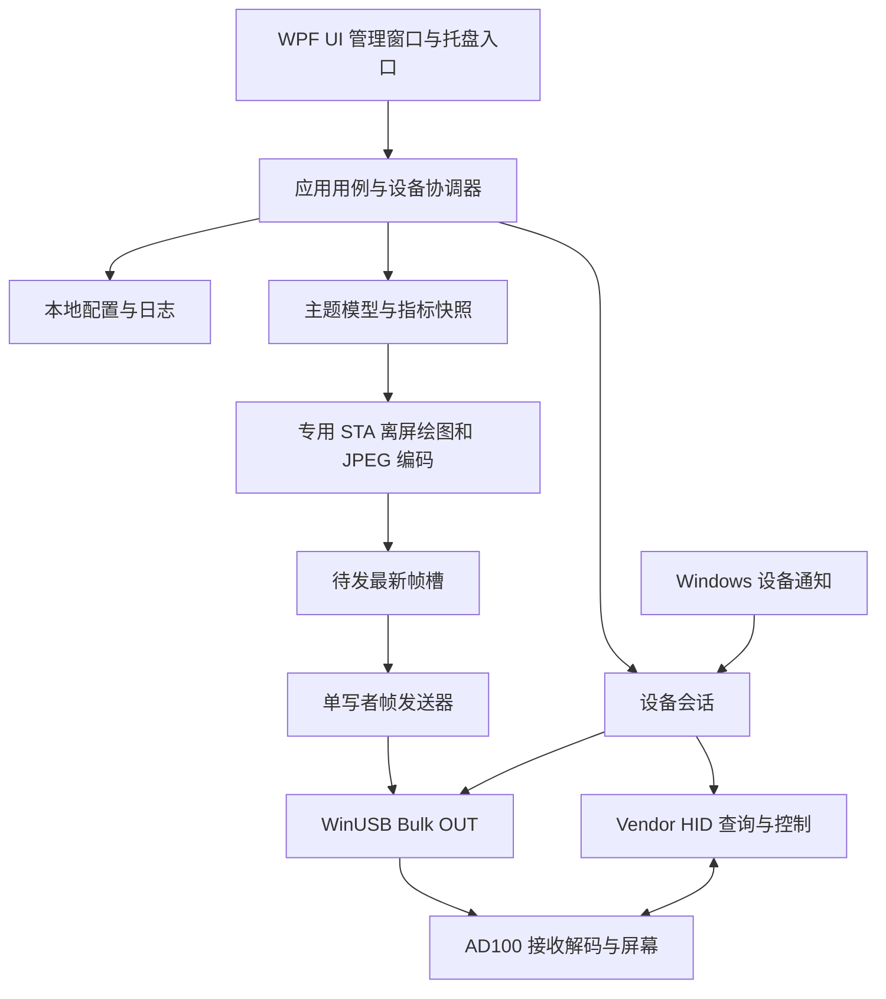

# USB Display 上位机｜软件技术架构

设计基线：v0.5　文档更新：2026-10-14

## 1. 架构决策

采用 **C# / .NET 10 LTS + WPF/XAML + WPF UI + CommunityToolkit.Mvvm 的模块化单体**。应用正常运行时单进程，在本机完成设备管理、内容绘制、JPEG 编码、USB 传输、配置与诊断；安装更新时由 Velopack 辅助进程接管。用例与协议规则放在不依赖 Windows 的 Core 中，系统能力通过窄接口接入。

展示层采用 **WPF UI（lepoco/wpfui，NuGet 包 WPF-UI）**：FluentWindow／TitleBar 组成主窗口，NavigationView 承载五个一级页面，主题资源与控件统一设置、对话框和提示。项目只补充语义资源及设备状态、内容预览等业务组件。管理窗口、主题内容、设备反馈分别建模；页面布局、控件映射、交互状态和验收矩阵见 [UI 设计规范](06_UI设计规范.md)。[WPF UI 官方仓库](https://github.com/lepoco/wpfui)

本方案基于 Windows 驱动、托盘、设备通知和原生 USB 接口等需求提出。WPF 是 Windows 桌面框架；.NET 10 是本次运行时基线，建项时固定 SDK 补丁。[WPF](https://learn.microsoft.com/en-us/dotnet/desktop/wpf/)、[.NET 支持政策](https://dotnet.microsoft.com/en-us/platform/support/policy)

### 1.1 选型结论与取舍

架构以单设备、离线运行、1～5fps 内容和 Windows 原生通信为约束。当前最合适的基线是轻量模块化单体；性能结论由 G0 实验决定，选用某个框架不能代替样机验证。

| 决策 | 采用理由 | 代价与重新评估条件 |
|---|---|---|
| WPF 管理界面 | 原生控件、绑定、桌面窗口和现有绘图体系覆盖首版需求 | Windows 专用；出现已批准的跨平台需求时重评 |
| 四个生产工程 | 编译边界隔离纯规则、Windows 适配和渲染，设备用例能离线测试 | Core 内按功能目录组织；不为每个用例再增程序集 |
| CommunityToolkit.Mvvm | 连接、应用、切换均需异步命令、忙碌通知和取消，复用成熟实现 | 只进入 Desktop；设备操作互斥仍由 Core 负责 |
| WPF UI 展示层 | 复用一致的窗口、导航、主题、输入控件与提示，减少通用控件模板维护 | 引入第三方依赖；锁定版本与许可，实测标题栏、DPI、键盘及高对比度；升级须回归 |
| WPF 离屏绘图＋编码适配器 | 同一内容模型产生设备帧和预览，中文与本地图片集成直接 | 编码格式、速度是待验证项；只替换未达标模块 |
| 显式组合根与生命周期 | 当前对象数量可控，构造函数注入能表达依赖和所有权 | 新增长期服务时仍须说明启动、停止及释放顺序 |

核心运行不引入远程业务服务、消息中间件或独立数据库。软件更新仅连接受控的发布源，不要求自建业务后端。原生 I/O、传感器和渲染也不预先拆进程；只有可复现的崩溃隔离或权限需求才触发进程边界评审。

## 2. 技术组成与选型理由

| 领域 | 本版方案 | 选择依据与边界 |
|---|---|---|
| 窗口和交互 | WPF/XAML＋WPF UI、MVVM | FluentWindow、TitleBar、NavigationView 负责窗口与页面；Desktop 内适配导航和提示服务 |
| 控件与主题 | WPF UI 主题字典、常用控件＋项目语义资源 | 复用 NumberBox、ContentDialog、Snackbar 等；少量资源覆盖，不复制维护整套控件模板 |
| MVVM 基础 | CommunityToolkit.Mvvm | ObservableObject／ObservableValidator、RelayCommand／AsyncRelayCommand；不自行实现命令框架 |
| 托盘 | Windows Forms NotifyIcon，封装在桌面项目 | 复用 Windows 桌面已有能力，负责释放图标及事件 |
| 设备发现 | SetupAPI、设备接口通知 | 按接口和稳定身份关联，不依赖定时全量扫描 |
| 主题数据面 | WinUSB 原生 API 的窄封装 | 直接使用 Windows 已绑定接口，无需跨平台 USB 层 |
| 控制面 | Windows HID API、异步 ReadFile/WriteFile | 依据描述符匹配 vendor collection，支持两态控制 |
| 内容渲染 | DrawingVisual + RenderTargetBitmap | 时钟、图片和低频仪表盘先使用现有平台绘图能力 |
| JPEG | JpegBitmapEncoder 的适配器 | 先验证输出格式和设备解码，不假设可控制全部 JPEG 参数 |
| 状态处理 | 显式状态枚举＋单一事件处理者 | 状态少且转移需要可审查，不引入状态机框架 |
| PC 基础指标 | Windows 系统 API | CPU 使用率、物理内存；不把 WMI 泛化为所有温度来源 |
| 可选温度采集 | 隔离接口下验证 LibreHardwareMonitor | 硬件／权限／驱动兼容验证通过再交付 |
| 配置 | System.Text.Json、本地文件 | 当前没有数据库查询和多用户同步需求 |
| 日志 | Serilog＋File sink＋有界 Async sink | JSON 结构化滚动文件，后台落盘；不自行实现日志轮转 |
| 安装与软件更新 | Velopack＋受控 HTTPS 静态发布源 | 复用检查、包下载及进程外应用更新能力，应用负责 UI 和设备清理；具体工具版本在 T-31 锁定 |
| 测试 | MSTest；原生适配器模拟＋实机集成测试 | 协议纯逻辑可离线验，驱动和显示必须实机验 |

MVVM Toolkit 不依赖特定 UI 框架；AsyncRelayCommand 提供执行状态与取消入口。ViewModel 显式观察命令任务并转译失败，不能将库的取消标志当成设备已取消。[MVVM Toolkit](https://learn.microsoft.com/en-us/dotnet/communitytoolkit/mvvm/)、[AsyncRelayCommand](https://learn.microsoft.com/en-us/dotnet/communitytoolkit/mvvm/asyncrelaycommand)

WPF UI 只负责管理界面的展示与交互，不拥有设备会话、更新状态或内容渲染。NavigationView 的页面创建与导航服务由 Desktop 组合根提供，ViewModel 使用注入的桌面交互接口，不从全局容器取服务。组合根显式管理启动与释放，无需额外宿主框架。主题资源和导航 API 以 T-07 锁定版本为准，在 T-29 验证后固化；库提供的能力不能代替产品可访问性验收。[导航文档](https://wpfui.lepo.co/documentation/navigation-view.html)、[主题文档](https://wpfui.lepo.co/documentation/themes.html)

WPF 原生绘图与编码作为首版管线。只有基准测试发现原生绘图不能达到 PRD 目标时，才评估替换渲染器；只有 JPEG 格式或性能验证失败时，才评估 WIC 精细配置或 libjpeg-turbo。变更必须提供失败样本和比较结果，不同时维护两套首版管线。

RenderTargetBitmap 用于生成图像，JpegBitmapEncoder 提供 JPEG 编码与质量设置；这不构成 4:2:0、硬件解码兼容或目标帧率保证。[RenderTargetBitmap](https://learn.microsoft.com/en-us/dotnet/api/system.windows.media.imaging.rendertargetbitmap)、[JpegBitmapEncoder](https://learn.microsoft.com/en-us/dotnet/api/system.windows.media.imaging.jpegbitmapencoder)

## 3. 系统结构



副屏态由厂商显示驱动输出桌面，帧发送器停用。模式切换依赖固件重枚举，应用不得在副屏态抢占显示接口。

## 4. 工程边界

以下是计划结构，当前仓库尚无这些应用工程：

```text
src/
  UsbDisplayHost.Desktop/       WPF UI 窗口与导航、ViewModel、托盘、组合根
  UsbDisplayHost.Core/          设备状态、应用用例、模型、接口、协议编码
  UsbDisplayHost.Windows/       SetupAPI、WinUSB、HID、指标、文件存储与日志
  UsbDisplayHost.Rendering/      WPF 离屏绘图、图像读取与 JPEG 编码
tests/
  UsbDisplayHost.Core.Tests/     纯协议和用例测试
  UsbDisplayHost.Windows.Tests/  Windows 适配与硬件测试
  UsbDisplayHost.Desktop.Tests/  ViewModel、命令和 UI 状态投影测试
  UsbDisplayHost.Rendering.Tests/ STA 渲染、格式与输出尺寸测试
docs/
  01_需求分析.md … 06_UI设计规范.md
  参考资料/
```

依赖方向：Desktop → Core/Windows/Rendering；Windows 和 Rendering → Core；Core 不引用 UI 或 Windows 原生句柄。Desktop 在启动入口创建具体对象并注入构造函数，不引入服务定位器。

Desktop、Windows、Rendering 使用 net10.0-windows，Core 使用 net10.0。桌面与渲染项目启用 WPF；桌面项目因 NotifyIcon 启用 Windows Forms 互操作。首版发布目标 win-x64，具体 Windows 11 build 在 G0 兼容矩阵中冻结。

WPF-UI 与 CommunityToolkit.Mvvm 只由 Desktop 引用。WPF UI 的导航、对话框、通知和主题服务留在 Desktop；Core、Windows、Rendering 均不引用 WPF-UI。Rendering 仅使用 WPF 绘图 API，不加载管理窗口资源或控件，不将 WPF UI 页面截图作为设备内容。托盘继续由封装后的 NotifyIcon 提供，与窗口使用同一组 Core 用例。

测试项目可引用相应实现，但生产程序集不能引用测试工程。硬件测试必须显式选择设备，不能在普通离线测试中自动切换设备模式。

Core 内以 Devices、Sessions、Themes、Protocol、Configuration 分目录。DeviceCoordinator 只拥有设备状态转移和操作调度；分片、主题应用、素材存储、恢复规则各由对应模块处理，避免将所有逻辑集中进协调器。

Desktop 只有组合根可以创建 Windows／Rendering 实现。ViewModel 构造函数接收 Core 用例、快照订阅和桌面交互接口，不接收原生适配器；文件对话框、窗口导航与 Dispatcher 留在 Desktop。UI 的命令启用规则来自 Core 的操作可用性结果，提交时 Core 再按最新状态检查，避免托盘与窗口的判断不同步。

## 5. 核心模型与接口

| 对象／接口 | 内容与职责 |
|---|---|
| DeviceIdentity | VID/PID、序列号、容器或位置辅助信息；不以 PID 作为永久设备键 |
| DeviceCapabilities | 协议版本、尺寸、帧与传输上限、支持命令、反馈能力；记录来源和是否已确认 |
| DeviceSnapshot | 不可变的连接、模式、电源、推流、反馈与操作可用性；带单调 SnapshotVersion，供 UI 只读 |
| DeviceProfile | 已持久化的恢复配置：主题、方向、亮度意图、刷新和画质；不等同设备实际显示 |
| ThemeDraft／ActiveProfile | 内存编辑候选／当前会话使用的配置；与 DeviceProfile 分开，记录修订号 |
| SceneModel | 图片／文字／仪表布局与样式的白名单数据 |
| MetricSnapshot | 来源、名称、值、单位、采样时间、可用／过期状态 |
| EncodedFrame | JPEG 字节、物理尺寸、单调生成时间、会话代次、内容修订号、帧号；拥有其缓冲 |
| DeviceCoordinator | 串行执行连接、配置、切换、恢复和关闭 |
| IDeviceDiscovery | 初始枚举、设备到达／离开通知 |
| IDisplayTransport | 会话打开、端点信息、完整写入、控制请求、取消和关闭 |
| IControlChannel | HID 查询、命令结果、报告订阅 |
| IFrameRenderer | 从内容模型生成完整编码帧 |
| IMetricProvider | 返回有时间戳的指标快照；失败不终止推流 |
| IProfileStore | 读取、验证、保存配置；返回恢复情况 |
| OperationOutcome | 操作号、成功／失败／取消／结果未知、错误编号；主题应用另列传输、保存、呈现三项结果 |
| IAppUpdateService／AppUpdateSnapshot | 检查、下载、待安装包和更新状态；Windows 适配 Velopack，Core 不暴露 SDK 类型；与设备会话状态独立 |

接口按现有责任定义，不设计通用插件系统。USB 写入结果记录请求长度、实际长度和系统错误；业务层不得只收到一个无法解释的 true/false。

时间超时、帧龄和重试间隔通过注入 TimeProvider 的单调时钟计算，日志才使用日历时间。用户修改系统时间不能延长切换超时，也不能把指标判为未来数据。

## 6. 并发与资源所有权

| 执行单元 | 责任 | 约束 |
|---|---|---|
| UI Dispatcher | 界面与绑定 | 不等待 USB、编码或文件 I/O |
| 设备事件循环 | 状态唯一写者、命令排序、恢复决策 | I/O 完成回送事件，不阻塞事件循环直到超时 |
| 渲染 STA 线程 | 创建 DrawingVisual、图像与编码器 | 专用 Dispatcher；不访问管理窗口的 Visual 树 |
| Bulk 发送循环 | 每次发送一个完整帧的分片序列 | 一个在途写；命令只能在完整帧边界插入 |
| HID 接收循环 | 持续读取、解析、发布事件 | 与 Bulk 独立，发送暂停时仍可接收 |
| 指标定时任务 | 1Hz 采样 | 上次未完成不叠加执行 |

事件处理者可以发起有超时的异步操作，完成时携带会话代次返回。离线事件优先使旧会话失效；旧完成事件不能覆盖新状态。

用例提交和完成事件均携带操作号。模式切换、应用主题、熄屏、恢复等冲突操作由协调器互斥受理，忙碌时返回明确原因，不能仅依赖按钮禁用。设备离开与关闭通过会话取消源立即使代次失效，再由事件循环收敛状态；即使存在在途应用或切换也可处理。

调度使用有界 Channel 或等价队列。生命周期与操作完成事件不丢弃，按受理操作数限制生产；指标、预览及重复设备变更通知仅保留最新快照／待重新枚举标志。设备回调只发信号；禁止阻塞系统通知线程等待队列空间，也不为每个回调堆积 Task.Run。

帧队列使用一个“待发最新帧槽”，加一个正在发送的帧。新帧仅替换尚未开始发送的旧帧；已发送部分分片的帧不能被新帧截断。被替换缓冲即时释放，发送缓冲在原生 I/O 完成或取消确认后释放。

会话代次解决重连污染，内容修订号解决同一会话内的旧主题污染。应用新主题、旋转或改变编码设置时递增修订号；渲染完成、进入槽和开始发送时都核对它。旧修订的在途帧可完整结束，之后只发送新修订；旧任务迟到不能覆盖新内容。

渲染调度最多一个执行中请求，活动内容与编辑预览各一个可替换请求。活动内容按其刷新预算优先，主题编辑合并更新；编辑内容只进入预览，绝不进入设备发送槽。预览更新也只保留最新值，UI Dispatcher 最多一个待处理更新；窗口隐藏后停发预览通知，设备管线照常运行。

控制操作不使用丢弃式队列。切模式时拒绝重复切换；连续亮度拖动只合并尚未发出的目标值，最终值必须执行并确认。拔出、取消和会话失效不得被普通状态通知淹没。

Bulk 命令和图像共用单写者；HID 写也只有一个执行者，读循环独立。EP0 查询避免重叠执行；涉及 reset／电源／模式的请求必须经过协调器，不能与帧发送自行竞争。

关闭顺序：停止接收新操作 → 停止产帧 → 取消并等待原生 I/O 收敛 → 结束 HID 接收 → 释放传输和原生句柄 → 关闭渲染 Dispatcher → 释放托盘。SafeHandle 封装句柄；禁止仍在 I/O 使用时释放缓冲。

### 6.1 原生异步边界

WinUSB／HID 适配器使用 overlapped I/O，每个请求独占缓冲、OVERLAPPED 及完成状态，封装成 Task；分别处理同步完成、ERROR_IO_PENDING 和立即失败。取消请求与完成通知允许竞态，结果只结算一次。取消后仍等待真实完成，再释放资源；托管超时不能通过遗弃 Task 实现。Windows 的取消 API 本身不保证操作已终止。[取消待处理 I/O](https://learn.microsoft.com/en-us/windows/win32/fileio/canceling-pending-i-o-operations)

### 6.2 应用生命周期

ApplicationLifetime 拥有发现订阅、协调器、渲染线程、指标任务、托盘和日志；在显式退出时统一停止。采用 WPF OnExplicitShutdown，隐藏主窗口不释放会话；窗口重开复用当前快照，不重新握手。

同一用户会话使用命名互斥量保持单实例；再次启动仅通知已有实例显示窗口，然后退出，不打开设备。不同 Windows 登录会话及其他程序仍可能占用设备，打开失败显示“设备被占用”，不抢占接口。正常退出等待清理与日志刷新；系统关机采用有界清理，未结束的原生请求保持资源所有权至进程终止。

## 7. 设备发现与驱动

启动时先订阅设备通知，再枚举并按设备接口路径去重协调，关闭订阅与初次枚举之间的漏报窗口；设备变更、切换超时及休眠恢复时重新枚举。回调只提交事件，不直接执行复杂连接流程。

目标设计为 VID 0xA108，副屏 PID 0xAD11，主题 PID 0xADA0。0xAD10 是源文现有单 display 形态，仅可作为显式研发兼容配置，不默认归入正式双模设备。

发现主题接口后读取接口描述符和管道列表，确认 vendor display 接口、Bulk OUT、最大包长与传输限额。不得写死端点地址 0x01。HID 通过 VID/PID、Usage Page/Usage、序列号及物理关联匹配，不能误开触摸 collection。

重枚举后路径与句柄全部重新获取。优先以唯一序列号关联同一设备；Container ID 或位置只能作为辅助。身份缺失或重复且存在歧义时停止自动接管，请用户重新选定。

主题态需 MI_00 正确绑定 WinUSB；副屏态需匹配的显示驱动；HID 使用系统驱动。支持自动安装的固件必须提供正确的 Microsoft OS 描述符和接口标识，不能仅改变 PID 就宣称免配置。Microsoft OS 1.0 的索引 0xEE 字符串与返回的 vendor request code 是不同概念。[WinUSB 安装说明](https://learn.microsoft.com/en-us/windows-hardware/drivers/usbcon/automatic-installation-of-winusb)

正式安装流程不要求用户使用 Zadig。开发期手工绑定必须记录具体接口，不能改变整台复合设备或其他设备的驱动。

## 8. 会话状态与模式

连接状态与屏幕电源分开建模：

- 连接状态：Disconnected、Opening、ThemeReady、ScreenReady、Switching、Recovering、Faulted。
- 屏幕电源：Unknown、On、Off。
- 推流状态：Stopped、Running、Paused。
- 切换上下文：原模式、目标模式、开始时间、操作号、会话代次。

| 当前状态 | 事件 | 行为与结果 |
|---|---|---|
| Disconnected | 选定设备到达 | Opening，读取描述符和能力 |
| Opening | 主题接口有效、协商完成 | ThemeReady；根据电源意图决定推流 |
| Opening | 副屏接口和控制可用 | ScreenReady；不打开显示数据面 |
| Opening | 能力冲突／驱动异常 | Faulted，记录可操作原因 |
| ThemeReady／ScreenReady | 用户切换 | Switching；停冲突工作后发送控制 |
| Switching | 同设备目标态可操作 | 对应 Ready；仅见 PID 不算完整成功 |
| Switching | 超时 | 重新枚举并核实；原态就绪则显示失败且保持原态，否则 Faulted／Disconnected |
| Ready | 传输结果不确定 | Recovering，停止帧管线 |
| 任意状态 | 设备离开 | 旧会话失效；切换期继续等待目标枚举，其余进入 Disconnected |
| Recovering | 一次恢复成功／失败 | Ready／Faulted；失败不无限重试 |

ThemeReady 的推流准备要求尺寸与限额合法、状态位匹配冻结协议、完整协商成功。ScreenReady 要求显示驱动绑定正确且系统显示路径可用，不能只检查 PID；有 HID 时还需重新建立控制通道。

## 9. 主题态握手

1. 打开经过身份确认的 WinUSB 接口，读取管道信息与限额。
2. 读取 specific descriptor、必要的 EDID、固件能力；进行长度、范围、一致性校验。
3. 读取 GET_STATUS，按冻结的位掩码判断 ready。0x18 是源文正常示例，不在未定义保留位语义前机械要求完全相等。
4. 按顺序发送 COLOR_FORMAT、宽高高低字节、BACKLIGHT、AUTORLX=0、MJPEG=1、BLANK_MODE=ON。
5. 各命令写入长度正确后再开始完整 JPEG；任一步失败停止握手并报告。
6. 断开或模式改变使全部在途结果失效。

以上步骤用于需要亮屏的主题会话。若设备或用户意图为 Off，连接恢复先恢复控制通道并保持停流；冻结协议必须定义不意外点亮的初始化／唤醒顺序。不得在熄屏后每次恢复都无条件执行 BLANK_MODE=ON。

EP0 草案（源文 S1 B7）：

| bmRequestType | bRequest | 参数与结果 |
|---|---|---|
| 0xC1 | 0x01 | GET_STATUS，1 字节 |
| 0xC1 | 0x02 | GET_EDID，wValue 为偏移，按约定分块 |
| 0xC1 | 0x03 | SOFT_RESET，零长度数据阶段；parser 清理范围待确认 |
| 0xC1 | 0x04 | GET_BACKLIGHT，1 字节 |
| 0x81 | 0x06 | specific descriptor，wValue=0x1F00；校验实际长度与内容 |

wIndex 使用实际接口号。源文 CLASS/VENDOR 数值冲突必须通过固件和抓包关闭；不能以同一个数值实现两种语义。

## 10. JPEG 编码与分片

### 10.1 渲染和编码

SceneModel 以设备内容逻辑尺寸布局。0°/180° 时逻辑画布为 W×H，90°/270° 时为 H×W，旋转后仍输出物理 W×H。以像素尺寸和 96 DPI 创建离屏目标，避免桌面 DPI 改变设备输出大小。

图片先解码、应用方向信息并合成不透明背景，再绘制文字与指标。预览使用同一帧的冻结图像或独立复制的不可变结果；窗口缩放只影响预览，不影响设备分辨率。管理窗口最小化或关闭到托盘不停止渲染线程。

设备帧按物理像素渲染；管理 UI 按 DIP 布局，两者不共享控件树。Core 的渲染接口不返回 BitmapSource；JPEG 及帧元数据通过平台无关结果返回，Desktop 的预览适配器读取最新结果并在后台解码、Freeze 后更新 Image。编辑内容帧标记为 Draft，活动帧标记为 Active；首页只订阅 Active，主题页只订阅当前编辑修订。预览解码失败不改变设备会话状态。预览取得独占 JPEG 副本后才允许发送器释放原缓冲；最多一个解码中副本和一个待处理副本，不持有已归还池的内存。解码图按可视尺寸约束缓存，页面关闭即释放，帧发送不等待 UI 消费。

DrawingVisual 不直接跨线程交给窗口；可冻结对象必须实际 Freeze 成功，不能仅因类型是 Freezable 就假定可共享。窗口更新始终经 UI Dispatcher，旧 SnapshotVersion 不覆盖新值。[WPF 线程模型](https://learn.microsoft.com/en-us/dotnet/desktop/wpf/advanced/threading-model)、[Freezable](https://learn.microsoft.com/en-us/dotnet/desktop/wpf/advanced/freezable-objects-overview)

首轮验证检查 JPEG SOF、宽高、色彩和采样、完整解码及实际屏幕。目标是设备支持的基线 JPEG；源文要求 4:2:0，若内置编码器无法满足实际固件要求，替换编码适配器后重新验收，不能通过只检查 FF D8 放行。

JPEG 最大有效长度暂取 1,048,576 字节，与经验证固件上限取较小值。质量从配置值开始，按 5 递减到 70，每帧最多 4 次编码；默认 80 对应 80→75→70。仍超限则丢弃该帧并提示调整内容，不切断 JPEG、不擅自改变协议分辨率。

### 10.2 分片约束

- 0x68 头长 8 字节；0x69 头长 11 字节。
- 偏移与长度为 24 位大端；全帧 pixel_offset=0。
- 单帧只允许最后一片使用 0x69；其余使用 0x68。
- 分片长度包含头部，不得超过 T。
- T=min(240×1024，固件已验证 max_transfer，WinUSB 允许的最大传输长度)，且必须大于 11。
- 空帧、越界帧或非法 JPEG 不发送。

分片决策伪代码，仅描述协议算法，不是驱动实现：

```text
offset = 0
while offset < jpegLength:
    remaining = jpegLength - offset
    if remaining <= T - 11:
        type = 0x69
        headerLength = 11
        payloadLength = remaining
    else:
        type = 0x68
        headerLength = 8
        payloadLength = min(T - 8, remaining - 1)
    写入同一决策生成的 type、offset、payloadLength
    仅 type=0x69 写入 pixel_offset=0
    写入 payloadLength 字节 JPEG
    完整发送 headerLength + payloadLength 字节
    offset += payloadLength
```

remaining-1 保证中间片不会吃完所有数据，从而遗漏结束片。例如 T=245760、JPEG 长度 T-10 时，首片取 T-11 个数据字节，最后保留 1 字节，由 0x69 结束。原始示例在相近边界可能写 0x68 却附加尾片字段，本版不复用该代码。

### 10.3 USB 写边界与结果

每个协议分片作为一个逻辑写请求，但主机 API 调用结束不代表固件按同一边界收包。必须验证 512 字节整倍数、非整倍数、连续请求和停止推流的接收行为。

需要 ZLP 的固件配置使用 SHORT_PACKET_TERMINATE，并验证接收侧行为；该策略可让最大包长整倍数的 OUT 写追加零长度包。禁止为了凑长度在协议末尾填未定义字节。[WinUSB 管道策略](https://learn.microsoft.com/en-us/windows-hardware/drivers/usbcon/winusb-functions-for-pipe-policy-modification)

写超时、短写和取消都可能意味着设备已接收部分数据。停止当前帧，等待原生操作收敛，进入恢复；不得盲目补余量或重发该片。WinUSB_ResetPipe 只处理管道，不等于设备 JPEG parser 已清空。

## 11. HID 协议冻结要求

S2 的 Report ID 1/2/3 和 0x30+ 命令仅是草案，具体字节格式须经主机与固件双方确认后使用。

协议冻结文件必须包含：

| 项目 | 必须明确的内容 |
|---|---|
| 设备与 collection | Usage Page、Usage、Report descriptor、身份关联 |
| 长度 | Input/Output/Feature 长度，是否包含 Report ID，填充字节规则 |
| 版本／能力 | 协议版本、可用命令、尺寸与限额、未知位处理 |
| 状态 | 模式、电源、亮度、温度单位、无效值、计数回绕 |
| 控制 | 模式切换、查询、纯熄屏／唤醒、错误返回 |
| 确认 | 操作序号或等价关联、受理与执行完成区分、超时后查询方式 |
| 重复与重启 | 重复命令语义、会话重建后旧应答如何失效 |
| 切换 | ACK 是否先于 USB 断开；丢 ACK 时以目标重枚举和就绪核验 |

通过 HidP_GetCaps 取得报告长度，不能在看到“64B”后固定申请 64 或 65 字节。持续输入使用 ReadFile，Feature 查询按冻结协议实现。[HIDP_CAPS](https://learn.microsoft.com/en-us/windows-hardware/drivers/ddi/hidpi/ns-hidpi-_hidp_caps)、[HID API](https://learn.microsoft.com/en-us/windows-hardware/drivers/hid/hid-api)

## 12. 模式切换和恢复

### 12.1 主题切副屏

停止产帧 → 等当前帧完成，超时则取消并收敛 I/O → 停止数据面操作并释放 WinUSB → 通过仍有效的 HID 发送切副屏命令 → 等旧设备离开／新设备出现 → 重新匹配身份、打开 HID、核验显示路径 → ScreenReady。

HID 也会在重枚举期间断开；不能“保留原句柄继续读”。若发命令前 HID 已不可用，停止切换并报告，不能强行从未协商的数据面补发。

### 12.2 副屏切主题

仅通过 HID 发切主题命令 → 等目标设备重枚举 → 打开主题接口 → 校验能力与握手 → 发送首帧 → ThemeReady。显示副屏窗口可能被 Windows 重新排列，不能承诺无缝保持桌面布局。

### 12.3 结果不确定

切换超时或 ACK 丢失先重新发现同一设备：目标已就绪则成功；原态确实就绪则报告切换未完成；无法确认则结果未知。自动补偿也必须是一次有确认的设备操作，首版不实施盲目往返补偿。

帧传输失败最多执行一次自动恢复周期：停止发送、收敛 I/O、确认设备仍在、执行经验证的 parser reset／会话重建、重新握手、发送最新完整帧。若 SOFT_RESET 不清拼帧残留，必须采用固件提供的有效重建方式；没有可靠方式时提示重新插拔并停流。

休眠时停止会话。唤醒后重新枚举并核验模式；只在已选定设备仍为主题态且允许显示时恢复推流，不把系统唤醒当作自动切主题授权。

## 13. 性能和反馈

静态图按需生成，时钟和指标按 1Hz 更新，渲染上限默认 5fps。内容未变化无需重复 JPEG 保活；状态查询独立进行。

发送吞吐不足时先替换待发旧帧；统计主机丢弃帧，不能无限排队。若写延迟持续超过帧预算且无协议错误，降低生成频率，最低 1fps；传输错误进入恢复，不用“降帧”掩盖不确定写入。连续稳定 30 秒后允许逐级回到用户上限，阈值在 M2 实测冻结。

分别记录 generated、hostDropped、usbCompleted、deviceDecoded、devicePresented；后两项无固件反馈时为空。USB 完成率不得命名为实际屏幕 FPS。

一张 1920×1080、32 位图像约 7.9MiB；限制原始绘图缓存、预览副本、在途 JPEG 和待发 JPEG 的数量。不得在每帧无限创建 UI 对象或保留历史位图。

## 14. 配置、指标与日志

### 14.1 主题应用与持久化

配置放在当前用户 LocalAppData 下，包含 schemaVersion、设备键、已应用内容与应用设置。临时文件写完再替换正式文件；保留一份可恢复配置。未知新版本不静默覆盖旧数据。用户选图复制到应用管理的本地素材目录，删除源文件不使已应用主题失效。

“已应用配置”指可供重连恢复的本地主机配置，不是设备的持久存储或已呈现证据。应用过程如下：

1. 协调器在主题就绪、亮屏且未暂停时受理，冻结本次编辑内容修订并分配操作号；此时不改变原活动主题和恢复配置。
2. 从固定修订生成不可变候选配置，校验素材、尺寸和编码，生成合法首帧；异步准备结束后再次检查会话和操作有效性。
3. 暂停旧主题产帧，在完整帧边界切到候选修订。候选首帧走同一发送器，完成前不得被普通刷新帧替换；首帧失败则停流进入恢复，不从残片续传。
4. 首帧 USB 完整写入后，更新 ActiveProfile，并原子保存 DeviceProfile。后续动态帧使用 ActiveProfile；设备呈现结果独立记录，缺少关联帧反馈时仍为未知。
5. 保存成功才显示“已发送，已保存”；仅传输成功则显示“已发送，保存失败”，保留 ActiveProfile 和编辑内容，提供“重试保存”。重试只写本地，不重新发送控制命令。

| 失败位置 | 当前会话 | 本地恢复配置 | 再次打开／重连 |
|---|---|---|---|
| 校验／素材准备失败 | 保留原活动主题 | 保留旧值 | 恢复旧配置，编辑内容可继续编辑 |
| 首帧写入失败或结果不确定 | 停流并核实／恢复，不宣称旧画面已恢复 | 保留旧值 | 经有效 parser 恢复后按旧配置出图 |
| 首帧已完成但保存失败 | 当前会话可继续候选主题 | 保留旧值，明确标未保存 | 恢复旧配置；不把未保存候选静默作为恢复值 |
| 传输与保存成功，呈现无反馈 | 使用候选主题 | 保存新值 | 恢复新配置；仍不宣称设备已显示 |

页面应用期间暂时禁用编辑，协调器冻结本次内容及修订；异步结果仍按设备键、会话代次和操作号核实。断连、切模式或退出与应用串行协调，旧操作不能覆盖新设备配置。无设备、副屏态、熄屏或暂停时，主题页只允许内存编辑与预览，不保存独立草稿文件。同一会话暂停／唤醒使用 ActiveProfile；重连或重启使用 DeviceProfile，均不自动应用未提交输入。

主题应用只提交主题字段，设备设置应用只提交方向／画质／帧率；候选配置与协调器受理时的其他已生效字段合并。即时亮度确认和保存也经过同一协调器，不允许旧表单快照覆盖新的亮度或主题。

素材目录中的编辑内容、活动和恢复配置引用均须保留；只清理已不被这些配置或在途应用引用的旧素材。禁止在新配置落盘前删除旧素材。

ThemeDraft 与 DeviceSettingsDraft 保留为内部不可变候选模型，不对应页面中的文件管理功能。Desktop 不再调用其独立读写接口；旧文件及底层兼容存储接口保持原样，素材引用扫描仍考虑遗留文件。切页保留内存输入，明确退出需确认放弃未应用修改。

### 14.2 输入、指标与诊断

图片候选限制为文件≤20MiB、解码像素≤2000万；实际分配前读取尺寸并检查乘法溢出。首版不导入主题压缩包和任意 XAML。

基础 CPU／内存采集失败按字段标不可用。温度扩展组件的支持硬件、授权和附带驱动须单独验证；MPL-2.0 及依赖许可随分发审查。首版不因传感器缺失要求主程序常驻管理员，也不预建特权服务。[LibreHardwareMonitor 官方仓库](https://github.com/LibreHardwareMonitor/LibreHardwareMonitor)

日志字段包括时间、等级、事件、匿名设备键、会话代次、操作号、状态迁移、错误码、请求／完成字节数与耗时。用户只看到可处理的说明和错误编号，原生错误详情保留本地日志。按 PRD 的 50MiB 总量上限滚动；诊断包不包含图片、原始 HID 数据洪流或内存转储。

日志实现由 Windows 工程适配，Core 仅依赖 Microsoft.Extensions.Logging.Abstractions，Serilog 通过日志提供程序在组合根接入。File sink 按大小轮转；Async sink 使用有界队列且不阻塞 UI／设备事件循环，逐帧成功信息先聚合。丢弃计数、磁盘写入失败在诊断页可见，错误通知不得递归写入失败的日志通道。正常退出刷新日志；精确文件上限及轮转时临时占用在 TC-19 验证，库默认值不能代替 50MiB 配额实现。[File sink](https://github.com/serilog/serilog-sinks-file)、[Async sink](https://github.com/serilog/serilog-sinks-async)

## 15. 交付与验证关口

发布为 Windows x64 自包含目录，通过 Velopack 生成当前用户安装包及软件更新包；首版不启用裁剪或 AOT。普通用户安装和更新应用，驱动安装单独申请所需权限；应用与驱动签名分别验证。应用升级不自行刷写固件或替换显示驱动。[Velopack Windows 安装说明](https://docs.velopack.io/packaging/operating-systems/windows)

进入完整实现前完成四项实验：

1. 原生绘图／JPEG 在 1920×1080 真机上的格式、中文、画质和性能。
2. WinUSB 分片、短包、ZLP、部分写及恢复。
3. HID 双态控制、重枚举身份和目标态判定。
4. 干净 Windows 环境的驱动安装和普通用户打开接口。

架构验证失败只调整对应模块和依赖任务，并同步 PRD 目标与协议表。软件构建成功不代替以上实机证据。

## 16. 软件检查更新与安装

### 16.1 实现边界与发布源

使用 Velopack 作为应用安装和更新引擎，不另写覆盖运行中 EXE/DLL 的脚本。应用设置的 ViewModel 调用 IAppUpdateService，Windows 工程负责 SDK、网络和包适配，ApplicationLifetime 负责安装交接。更新组件是应用级服务，不随设备重连或切页重建。

正式客户端只读取固定的 HTTPS 发布源和 win-x64 稳定通道；发布身份 packId 从首次安装起保持不变。发布源可使用静态站点或对象存储，提供 Velopack 生成的版本索引、完整包和更新说明；首版只发布完整包，不依赖差分包。域名、证书、发布权限和责任人在 T-31 冻结，未配置真实源时不得把演示地址写入正式安装包。[Velopack 分发说明](https://docs.velopack.io/distributing/overview)

版本按 SemVer 解析比较，不使用字符串排序；只推荐同产品、同架构、兼容 OS 的更高稳定版本，禁止自动降级。安装目标在下载时固定，后台发现另一版本不会偷偷改变待安装包。更新说明作为纯文本／受限 Markdown 展示，不执行 HTML 或脚本。

### 16.2 启动、检查与下载

WPF 使用显式 STA Main，先执行一次 Velopack 启动处理，再创建应用单实例锁、窗口、托盘和设备服务。安装／更新 hooks 快速退出，不启动设备发现，不被普通单实例处理误拦截。显式配置 SetAutoApplyOnStartup(false)，防止“稍后”在下次启动时被自动安装。使用 CheckForUpdatesAsync、DownloadUpdatesAsync 以及明确的应用更新入口；调用前后的产品状态由应用维护。[Velopack 集成契约](https://docs.velopack.io/integrating/overview)

正常启动完成后才安排后台检查，自动尝试间隔至少 24 小时；保存最近自动尝试时间、最近成功检查时间和结果。手动请求绕过间隔但不创建并行检查。网络使用系统代理与正常证书验证；检查有超时，下载流式写入缓存并支持取消，取消完成前不启动下一下载。不启用循环立即重试，检查／下载失败不会改变设备状态。

下载与校验仍在当前版本运行期间完成，阶段为 Idle、Checking、Available、Downloading、Verifying、ReadyToInstall、PreparingInstall、Failed。无更新是成功检查的结果，网络失败是 Failed；Installing 的真实结果须由更新程序和下次启动核验，主进程不能在退出前先标成功。

下载预检可用磁盘空间，预算包含完整包、解包和版本替换所需空间；传输完成后验证包大小和 SHA-256，校验失败不能进入 ReadyToInstall。包验证复用 SDK，T-31 核验选定版本的具体行为。发布源受 HTTPS 和发布权限控制；哈希用于完整性，不被当成独立的发布者身份认证。

正式发布流程对应用、自有可执行组件、Setup 和 Update 辅助程序签名并验签；签名密钥不进入客户端。包与索引由同一受控发布流程生成，先上传不可变版本包，再更新版本索引；避免索引已指向尚未上传完成的文件。Velopack 构建过程负责其辅助程序的签名接入，不只对主 EXE 签名；不假定 SDK 自动完成所有发布者校验。[Velopack 代码签名](https://docs.velopack.io/packaging/signing)

### 16.3 安装交接与设备清理

用户点击“重启并安装”后执行下列顺序：

1. 固定已验证的目标包，处理未保存应用设置、未应用内容及待保存恢复配置；必要保存失败则返回更新页。
2. 以 UpdateRestart 退出原因进入应用维护状态，拒绝新的设备写入；等待正在进行的应用／模式切换／恢复结束或安全取消。模式结果未知、原生 I/O 未收敛时不启动安装。
3. 停止产帧、收敛 Bulk／HID、释放句柄与预览、停止指标和更新网络任务，刷新日志。清理失败则保留当前进程并显示可恢复错误，不能交给更新器强杀以掩盖资源问题。
4. 调用明确的安装并重启入口，将文件替换交给 Velopack 辅助程序；不预先启动等待超时后会强杀应用的更新流程，也不安排普通退出后暗中安装。
5. 新版启动先核对目标版本和配置读取结果，窗口／托盘初始化成功后记录完成。设备按真实状态重新建立会话，沿用电源意图；本次重启跳过退出切副屏和启动自动切主题策略。

包交接前再次确认缓存文件仍完整；若启动更新器失败，主程序保持可诊断状态并允许重新连接设备。配置和更新意图位于独立的数据目录，例如 %LocalAppData%/UsbDisplayHost.Data，与安装目录及更新缓存分开，避免文件替换或卸载默认行为误删用户数据。

### 16.4 恢复与交付验证

应用更新不要求设备在线。升级后的配置迁移先备份、校验后原子替换；迁移失败保留原文件并显示修复入口，不静默写默认值覆盖。回退软件前核实旧版可读的 schema；旧版完整安装包和兼容配置备份通过明确恢复流程使用。

下载失败、文件占用、安装失败和新版本启动失败分别记录阶段与错误编号。新版本无法正常启动时，使用官方已签名完整安装包修复，并按说明获取更新器日志；自动健康回滚不作为首版保证。最终验收必须从旧版本真实安装升级到新版本，覆盖 TC-34～TC-38；SDK 的模拟测试不能代替安装验证。
