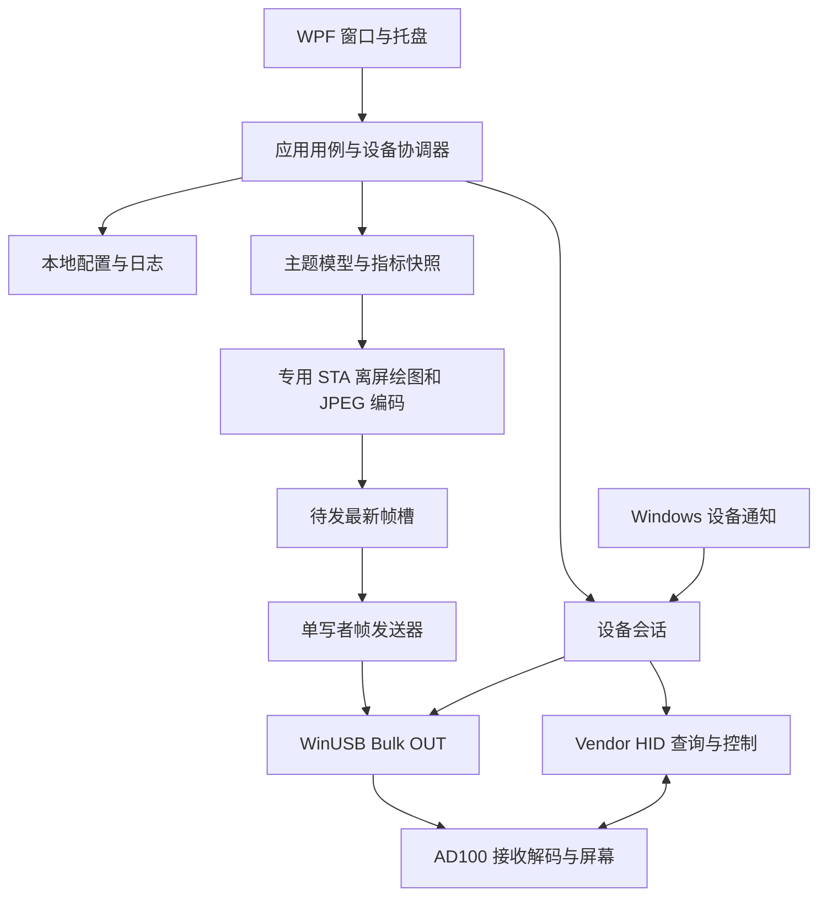

# USB Display 上位机｜软件技术架构

版本：v0.2 全面重写稿　日期：2026-10-06

## 1. 架构决策

采用 **C# / .NET 10 + WPF/XAML 原生桌面程序**，默认单进程，在本机完成设备管理、内容绘制、JPEG 编码、USB 传输、配置与诊断。

用户明确排除 Fluent UI、Blazor（含 Hybrid）和 Azure DevOps。实现中没有 WebView、Razor 页面、网页路由或相关平台依赖。界面使用 WPF 基础控件与本项目 ResourceDictionary 定义样式。

本方案基于 Windows 驱动、托盘、设备通知和原生 USB 接口等需求提出。WPF 是 Windows 桌面框架；.NET 10 是本次运行时基线，建项时固定 SDK 补丁。[WPF](https://learn.microsoft.com/en-us/dotnet/desktop/wpf/)、[.NET 支持政策](https://dotnet.microsoft.com/en-us/platform/support/policy)

## 2. 技术组成与选型理由

| 领域 | 本版方案 | 选择依据与边界 |
|---|---|---|
| 窗口和交互 | WPF/XAML、MVVM | 原生窗口、数据绑定、命令与样式即可满足设置和预览 |
| MVVM 基础 | INotifyPropertyChanged、ICommand、小型基础类 | 首版界面有限，不为架构引入应用框架 |
| 托盘 | Windows Forms NotifyIcon，封装在桌面项目 | 复用 Windows 桌面已有能力，负责释放图标及事件 |
| 设备发现 | SetupAPI、设备接口通知 | 按接口和稳定身份关联，不依赖定时全量扫描 |
| 主题数据面 | WinUSB 原生 API 的窄封装 | 直接使用 Windows 已绑定接口，无需跨平台 USB 层 |
| 控制面 | Windows HID API、异步 ReadFile/WriteFile | 依据描述符匹配 vendor collection，支持两态控制 |
| 内容渲染 | DrawingVisual + RenderTargetBitmap | 时钟、图片和低频仪表盘先使用现有平台绘图能力 |
| JPEG | JpegBitmapEncoder 的适配器 | 先验证输出格式和设备解码，不假设可控制全部 JPEG 参数 |
| 状态处理 | 显式状态枚举＋单一事件处理者 | 状态少且转移需要可审查，不引入状态机框架 |
| PC 基础指标 | Windows 系统 API | CPU 使用率、物理内存；不把 WMI 泛化为所有温度来源 |
| 可选温度采集 | 隔离接口下验证 LibreHardwareMonitor | 硬件／权限／驱动兼容验证通过再交付 |
| 配置 | System.Text.Json、本地文件 | 当前没有数据库查询和多用户同步需求 |
| 日志 | 本地结构化滚动文件 | 无网络采集服务和遥测外发依赖 |
| 测试 | MSTest；原生适配器模拟＋实机集成测试 | 协议纯逻辑可离线验，驱动和显示必须实机验 |

WPF 原生绘图与编码是本版的新选择，不把旧文的 SkiaSharp 作为既定依赖。只有基准测试发现原生绘图不能达到 PRD 目标时，才评估替换渲染器；只有 JPEG 格式或性能验证失败时，才评估 WIC 精细配置或 libjpeg-turbo。变更必须提供失败样本和比较结果，不同时维护两套首版管线。

RenderTargetBitmap 用于生成图像，JpegBitmapEncoder 提供 JPEG 编码与质量设置；这不构成 4:2:0、硬件解码兼容或目标帧率保证。[RenderTargetBitmap](https://learn.microsoft.com/en-us/dotnet/api/system.windows.media.imaging.rendertargetbitmap)、[JpegBitmapEncoder](https://learn.microsoft.com/en-us/dotnet/api/system.windows.media.imaging.jpegbitmapencoder)

## 3. 系统结构



副屏态由厂商显示驱动输出桌面，帧发送器停用。模式切换依赖固件重枚举，应用不得在副屏态抢占显示接口。

## 4. 工程边界

以下是计划结构，当前仓库尚无这些应用工程：

```text
src/
  UsbDisplayHost.Desktop/       WPF 窗口、ViewModel、托盘、组合根
  UsbDisplayHost.Core/          设备状态、应用用例、模型、接口、协议编码
  UsbDisplayHost.Windows/       SetupAPI、WinUSB、HID、指标、文件存储与日志
  UsbDisplayHost.Rendering/      WPF 离屏绘图、图像读取与 JPEG 编码
tests/
  UsbDisplayHost.Core.Tests/     纯协议和用例测试
  UsbDisplayHost.Windows.Tests/  Windows 适配与硬件测试
docs/
  01_需求分析.md … 05_项目规范.md
  参考资料/
```

依赖方向：Desktop → Core/Windows/Rendering；Windows 和 Rendering → Core；Core 不引用 UI 或 Windows 原生句柄。Desktop 在启动入口创建具体对象并注入构造函数，不引入服务定位器。

Desktop、Windows、Rendering 使用 net10.0-windows，Core 使用 net10.0。桌面与渲染项目启用 WPF；桌面项目因 NotifyIcon 启用 Windows Forms 互操作。首版发布目标 win-x64，具体 Windows 11 build 在 G0 兼容矩阵中冻结。

测试项目可引用相应实现，但生产程序集不能引用测试工程。硬件测试必须显式选择设备，不能在普通离线测试中自动切换设备模式。

## 5. 核心模型与接口

| 对象／接口 | 内容与职责 |
|---|---|
| DeviceIdentity | VID/PID、序列号、容器或位置辅助信息；不以 PID 作为永久设备键 |
| DeviceCapabilities | 协议版本、尺寸、帧与传输上限、支持命令、反馈能力；记录来源和是否已确认 |
| DeviceSnapshot | 连接状态、模式、电源、推流状态、最近反馈时间；供 UI 只读 |
| DeviceProfile | 已应用主题、方向、亮度意图、刷新和画质；与草稿分开 |
| SceneModel | 图片／文字／仪表布局与样式的白名单数据 |
| MetricSnapshot | 来源、名称、值、单位、采样时间、可用／过期状态 |
| EncodedFrame | JPEG 字节、物理尺寸、生成时间、会话代次；拥有其缓冲 |
| DeviceCoordinator | 串行执行连接、配置、切换、恢复和关闭 |
| IDeviceDiscovery | 初始枚举、设备到达／离开通知 |
| IDisplayTransport | 会话打开、端点信息、完整写入、控制请求、取消和关闭 |
| IControlChannel | HID 查询、命令结果、报告订阅 |
| IFrameRenderer | 从内容模型生成完整编码帧 |
| IMetricProvider | 返回有时间戳的指标快照；失败不终止推流 |
| IProfileStore | 读取、验证、保存配置；返回恢复情况 |

接口按现有责任定义，不设计通用插件系统。USB 写入结果记录请求长度、实际长度和系统错误；业务层不得只收到一个无法解释的 true/false。

## 6. 并发与资源所有权

| 执行单元 | 责任 | 约束 |
|---|---|---|
| UI Dispatcher | 界面与绑定 | 不等待 USB、编码或文件 I/O |
| 设备事件循环 | 状态唯一写者、命令排序、恢复决策 | I/O 完成回送事件，不阻塞事件循环直到超时 |
| 渲染 STA 线程 | 创建 DrawingVisual、图像与编码器 | 专用 Dispatcher；不访问管理窗口的 Visual 树 |
| Bulk 发送循环 | 每次发送一个完整帧的分片序列 | 一个在途写；命令只能在完整帧边界插入 |
| HID 接收循环 | 持续读取、解析、发布事件 | 与 Bulk 独立，发送暂停时仍可接收 |
| 指标定时任务 | 1Hz 采样 | 上次未完成不叠加执行 |

事件处理者可以发起有超时的异步操作，完成时携带会话代次返回。离线事件优先使旧会话失效；旧完成事件不能覆盖新状态。

帧队列使用一个“待发最新帧槽”，加一个正在发送的帧。新帧仅替换尚未开始发送的旧帧；已发送部分分片的帧不能被新帧截断。被替换缓冲即时释放，发送缓冲在原生 I/O 完成或取消确认后释放。

控制操作不使用丢弃式队列。切模式时拒绝重复切换；连续亮度拖动只合并尚未发出的目标值，最终值必须执行并确认。拔出、取消和会话失效不得被普通状态通知淹没。

关闭顺序：停止接收新操作 → 停止产帧 → 取消并等待原生 I/O 收敛 → 结束 HID 接收 → 释放传输和原生句柄 → 关闭渲染 Dispatcher → 释放托盘。SafeHandle 封装句柄；禁止仍在 I/O 使用时释放缓冲。

## 7. 设备发现与驱动

启动时枚举一次并订阅设备通知；设备变更、切换超时及休眠恢复时重新枚举。回调只提交事件，不直接执行复杂连接流程。

目标设计为 VID 0xA108，副屏 PID 0xAD11，主题 PID 0xADA0。0xAD10 是源文现有单 display 形态，仅可作为显式研发兼容配置，不默认归入正式双模设备。

发现主题接口后读取接口描述符和管道列表，确认 vendor display 接口、Bulk OUT、最大包长与传输限额。不得写死端点地址 0x01。HID 通过 VID/PID、Usage Page/Usage、序列号及物理关联匹配，不能误开触摸 collection。

重枚举后路径与句柄全部重新获取。优先以唯一序列号关联同一设备；Container ID 或位置只能作为辅助。身份缺失或重复且存在歧义时停止自动接管，请用户重新选定。

主题态需 MI_00 正确绑定 WinUSB；副屏态需匹配的显示驱动；HID 使用系统驱动。支持自动安装的固件必须提供正确的 Microsoft OS 描述符和接口标识，不能仅改变 PID 就宣称免配置。Microsoft OS 1.0 的索引 0xEE 字符串与返回的 vendor request code 是不同概念。[WinUSB 安装说明](https://learn.microsoft.com/en-us/windows-hardware/drivers/usbcon/automatic-installation-of-winusb)

正式安装流程不要求用户使用 Zadig。开发期手工绑定必须记录具体接口，不能改变整台复合设备或其他设备的驱动。

## 8. 会话状态与模式

连接状态与屏幕电源分开建模：

- 连接状态：Disconnected、Opening、ThemeReady、ScreenReady、Switching、Recovering、Faulted。
- 屏幕电源：Unknown、On、Off。
- 推流状态：Stopped、Running、Paused。
- 切换上下文：原模式、目标模式、开始时间、操作号、会话代次。

| 当前状态 | 事件 | 行为与结果 |
|---|---|---|
| Disconnected | 选定设备到达 | Opening，读取描述符和能力 |
| Opening | 主题接口有效、协商完成 | ThemeReady；根据电源意图决定推流 |
| Opening | 副屏接口和控制可用 | ScreenReady；不打开显示数据面 |
| Opening | 能力冲突／驱动异常 | Faulted，记录可操作原因 |
| ThemeReady／ScreenReady | 用户切换 | Switching；停冲突工作后发送控制 |
| Switching | 同设备目标态可操作 | 对应 Ready；仅见 PID 不算完整成功 |
| Switching | 超时 | 重新枚举并核实；原态就绪则显示失败且保持原态，否则 Faulted／Disconnected |
| Ready | 传输结果不确定 | Recovering，停止帧管线 |
| 任意状态 | 设备离开 | 旧会话失效；切换期继续等待目标枚举，其余进入 Disconnected |
| Recovering | 一次恢复成功／失败 | Ready／Faulted；失败不无限重试 |

ThemeReady 的推流准备要求尺寸与限额合法、状态位匹配冻结协议、完整协商成功。ScreenReady 要求显示驱动绑定正确且系统显示路径可用，不能只检查 PID；有 HID 时还需重新建立控制通道。

## 9. 主题态握手

1. 打开经过身份确认的 WinUSB 接口，读取管道信息与限额。
2. 读取 specific descriptor、必要的 EDID、固件能力；进行长度、范围、一致性校验。
3. 读取 GET_STATUS，按冻结的位掩码判断 ready。0x18 是源文正常示例，不在未定义保留位语义前机械要求完全相等。
4. 按顺序发送 COLOR_FORMAT、宽高高低字节、BACKLIGHT、AUTORLX=0、MJPEG=1、BLANK_MODE=ON。
5. 各命令写入长度正确后再开始完整 JPEG；任一步失败停止握手并报告。
6. 断开或模式改变使全部在途结果失效。

以上步骤用于需要亮屏的主题会话。若设备或用户意图为 Off，连接恢复先恢复控制通道并保持停流；冻结协议必须定义不意外点亮的初始化／唤醒顺序。不得在熄屏后每次恢复都无条件执行 BLANK_MODE=ON。

EP0 草案（源文 S1 B7）：

| bmRequestType | bRequest | 参数与结果 |
|---|---|---|
| 0xC1 | 0x01 | GET_STATUS，1 字节 |
| 0xC1 | 0x02 | GET_EDID，wValue 为偏移，按约定分块 |
| 0xC1 | 0x03 | SOFT_RESET，零长度数据阶段；parser 清理范围待确认 |
| 0xC1 | 0x04 | GET_BACKLIGHT，1 字节 |
| 0x81 | 0x06 | specific descriptor，wValue=0x1F00；校验实际长度与内容 |

wIndex 使用实际接口号。源文 CLASS/VENDOR 数值冲突必须通过固件和抓包关闭；不能以同一个数值实现两种语义。

## 10. JPEG 编码与分片

### 10.1 渲染和编码

SceneModel 以设备内容逻辑尺寸布局。0°/180° 时逻辑画布为 W×H，90°/270° 时为 H×W，旋转后仍输出物理 W×H。以像素尺寸和 96 DPI 创建离屏目标，避免桌面 DPI 改变设备输出大小。

图片先解码、应用方向信息并合成不透明背景，再绘制文字与指标。预览使用同一帧的冻结图像或独立复制的不可变结果；窗口缩放只影响预览，不影响设备分辨率。管理窗口最小化或关闭到托盘不停止渲染线程。

首轮验证检查 JPEG SOF、宽高、色彩和采样、完整解码及实际屏幕。目标是设备支持的基线 JPEG；源文要求 4:2:0，若内置编码器无法满足实际固件要求，替换编码适配器后重新验收，不能通过只检查 FF D8 放行。

JPEG 最大有效长度暂取 1,048,576 字节，与经验证固件上限取较小值。质量从配置值开始，按 5 递减到 70，每帧最多 4 次编码；默认 80 对应 80→75→70。仍超限则丢弃该帧并提示调整内容，不切断 JPEG、不擅自改变协议分辨率。

### 10.2 分片约束

- 0x68 头长 8 字节；0x69 头长 11 字节。
- 偏移与长度为 24 位大端；全帧 pixel_offset=0。
- 单帧只允许最后一片使用 0x69；其余使用 0x68。
- 分片长度包含头部，不得超过 T。
- T=min(240×1024，固件已验证 max_transfer，WinUSB 允许的最大传输长度)，且必须大于 11。
- 空帧、越界帧或非法 JPEG 不发送。

分片决策伪代码，仅描述协议算法，不是驱动实现：

```text
offset = 0
while offset < jpegLength:
    remaining = jpegLength - offset
    if remaining <= T - 11:
        type = 0x69
        headerLength = 11
        payloadLength = remaining
    else:
        type = 0x68
        headerLength = 8
        payloadLength = min(T - 8, remaining - 1)
    写入同一决策生成的 type、offset、payloadLength
    仅 type=0x69 写入 pixel_offset=0
    写入 payloadLength 字节 JPEG
    完整发送 headerLength + payloadLength 字节
    offset += payloadLength
```

remaining-1 保证中间片不会吃完所有数据，从而遗漏结束片。例如 T=245760、JPEG 长度 T-10 时，首片取 T-11 个数据字节，最后保留 1 字节，由 0x69 结束。原始示例在相近边界可能写 0x68 却附加尾片字段，本版不复用该代码。

### 10.3 USB 写边界与结果

每个协议分片作为一个逻辑写请求，但主机 API 调用结束不代表固件按同一边界收包。必须验证 512 字节整倍数、非整倍数、连续请求和停止推流的接收行为。

需要 ZLP 的固件配置使用 SHORT_PACKET_TERMINATE，并验证接收侧行为；该策略可让最大包长整倍数的 OUT 写追加零长度包。禁止为了凑长度在协议末尾填未定义字节。[WinUSB 管道策略](https://learn.microsoft.com/en-us/windows-hardware/drivers/usbcon/winusb-functions-for-pipe-policy-modification)

写超时、短写和取消都可能意味着设备已接收部分数据。停止当前帧，等待原生操作收敛，进入恢复；不得盲目补余量或重发该片。WinUSB_ResetPipe 只处理管道，不等于设备 JPEG parser 已清空。

## 11. HID 协议冻结要求

S2 的 Report ID 1/2/3 和 0x30+ 命令仅是草案。本次不编造可直接下发的新字节格式。

协议冻结文件必须包含：

| 项目 | 必须明确的内容 |
|---|---|
| 设备与 collection | Usage Page、Usage、Report descriptor、身份关联 |
| 长度 | Input/Output/Feature 长度，是否包含 Report ID，填充字节规则 |
| 版本／能力 | 协议版本、可用命令、尺寸与限额、未知位处理 |
| 状态 | 模式、电源、亮度、温度单位、无效值、计数回绕 |
| 控制 | 模式切换、查询、纯熄屏／唤醒、错误返回 |
| 确认 | 操作序号或等价关联、受理与执行完成区分、超时后查询方式 |
| 重复与重启 | 重复命令语义、会话重建后旧应答如何失效 |
| 切换 | ACK 是否先于 USB 断开；丢 ACK 时以目标重枚举和就绪核验 |

通过 HidP_GetCaps 取得报告长度，不能在看到“64B”后固定申请 64 或 65 字节。持续输入使用 ReadFile，Feature 查询按冻结协议实现。[HIDP_CAPS](https://learn.microsoft.com/en-us/windows-hardware/drivers/ddi/hidpi/ns-hidpi-_hidp_caps)、[HID API](https://learn.microsoft.com/en-us/windows-hardware/drivers/hid/hid-api)

## 12. 模式切换和恢复

### 12.1 主题切副屏

停止产帧 → 等当前帧完成，超时则取消并收敛 I/O → 停止数据面操作并释放 WinUSB → 通过仍有效的 HID 发送切副屏命令 → 等旧设备离开／新设备出现 → 重新匹配身份、打开 HID、核验显示路径 → ScreenReady。

HID 也会在重枚举期间断开；不能“保留原句柄继续读”。若发命令前 HID 已不可用，停止切换并报告，不能强行从未协商的数据面补发。

### 12.2 副屏切主题

仅通过 HID 发切主题命令 → 等目标设备重枚举 → 打开主题接口 → 校验能力与握手 → 发送首帧 → ThemeReady。显示副屏窗口可能被 Windows 重新排列，不能承诺无缝保持桌面布局。

### 12.3 结果不确定

切换超时或 ACK 丢失先重新发现同一设备：目标已就绪则成功；原态确实就绪则报告切换未完成；无法确认则结果未知。自动补偿也必须是一次有确认的设备操作，首版不实施盲目往返补偿。

帧传输失败最多执行一次自动恢复周期：停止发送、收敛 I/O、确认设备仍在、执行经验证的 parser reset／会话重建、重新握手、发送最新完整帧。若 SOFT_RESET 不清拼帧残留，必须采用固件提供的有效重建方式；没有可靠方式时提示重新插拔并停流。

休眠时停止会话。唤醒后重新枚举并核验模式；只在已选定设备仍为主题态且允许显示时恢复推流，不把系统唤醒当作自动切主题授权。

## 13. 性能和反馈

静态图按需生成，时钟和指标按 1Hz 更新，渲染上限默认 5fps。内容未变化无需重复 JPEG 保活；状态查询独立进行。

发送吞吐不足时先替换待发旧帧；统计主机丢弃帧，不能无限排队。若写延迟持续超过帧预算且无协议错误，降低生成频率，最低 1fps；传输错误进入恢复，不用“降帧”掩盖不确定写入。连续稳定 30 秒后允许逐级回到用户上限，阈值在 M2 实测冻结。

分别记录 generated、hostDropped、usbCompleted、deviceDecoded、devicePresented；后两项无固件反馈时为空。USB 完成率不得命名为实际屏幕 FPS。

一张 1080×2400、32 位图像约 9.9MiB；限制原始绘图缓存、预览副本、在途 JPEG 和待发 JPEG 的数量。不得在每帧无限创建 UI 对象或保留历史位图。

## 14. 配置、指标与日志

配置放在当前用户 LocalAppData 下，包含 schemaVersion、设备键、已应用内容与应用设置。临时文件写完再替换正式文件；保留一份可恢复配置。未知新版本不静默覆盖旧数据。用户选图复制到应用管理的本地素材目录，删除源文件不使已应用主题失效。

图片候选限制为文件≤20MiB、解码像素≤2000万；实际分配前读取尺寸并检查乘法溢出。首版不导入主题压缩包和任意 XAML。

基础 CPU／内存采集失败按字段标不可用。温度扩展组件的支持硬件、授权和附带驱动须单独验证；MPL-2.0 及依赖许可随分发审查。首版不因传感器缺失要求主程序常驻管理员，也不预建特权服务。[LibreHardwareMonitor 官方仓库](https://github.com/LibreHardwareMonitor/LibreHardwareMonitor)

日志字段包括时间、等级、事件、匿名设备键、会话代次、操作号、状态迁移、错误码、请求／完成字节数与耗时。用户只看到可处理的说明和错误编号，原生错误详情保留本地日志。按 PRD 的 50MiB 总量上限滚动；诊断包不包含图片、原始 HID 数据洪流或内存转储。

## 15. 交付与验证关口

发布为 Windows x64 自包含目录，并由安装包交付；首版不启用裁剪或 AOT。安装工具在驱动集成试验后锁定，应用与驱动签名分别验证。应用升级不自行刷写固件或替换不匹配的显示驱动。

进入完整实现前完成四项实验：

1. 原生绘图／JPEG 在 1080×2400 真机上的格式、中文、画质和性能。
2. WinUSB 分片、短包、ZLP、部分写及恢复。
3. HID 双态控制、重枚举身份和目标态判定。
4. 干净 Windows 环境的驱动安装和普通用户打开接口。

架构验证失败只调整对应模块和依赖任务，并同步 PRD 目标与协议表。软件构建成功不代替以上实机证据。
