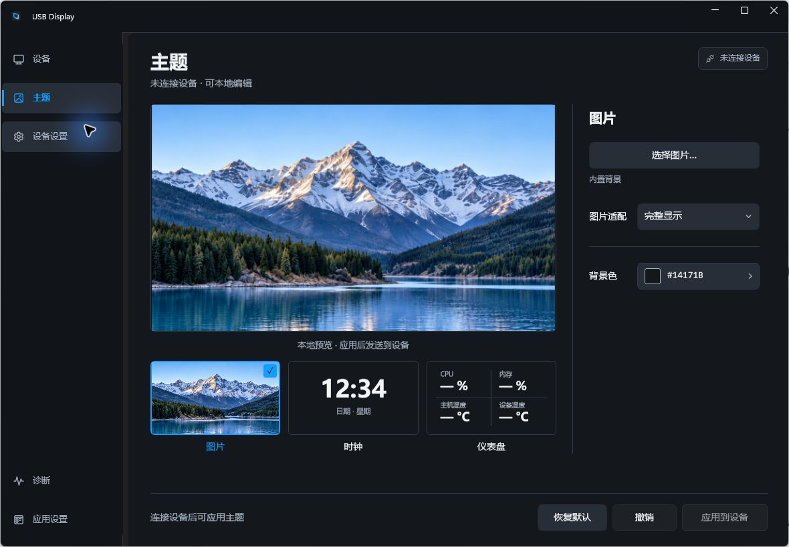
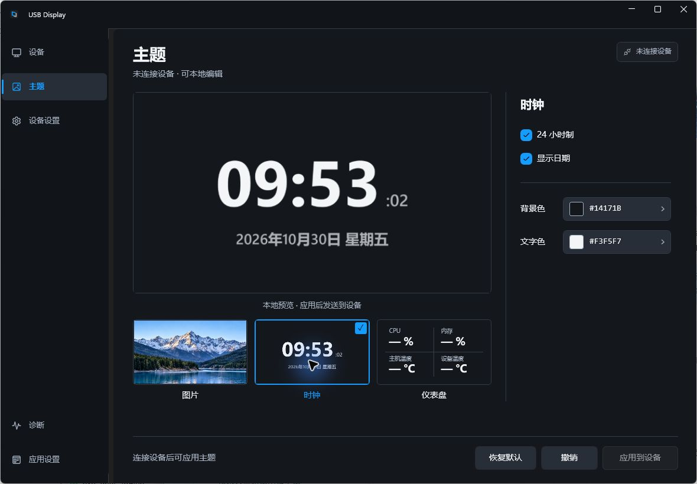
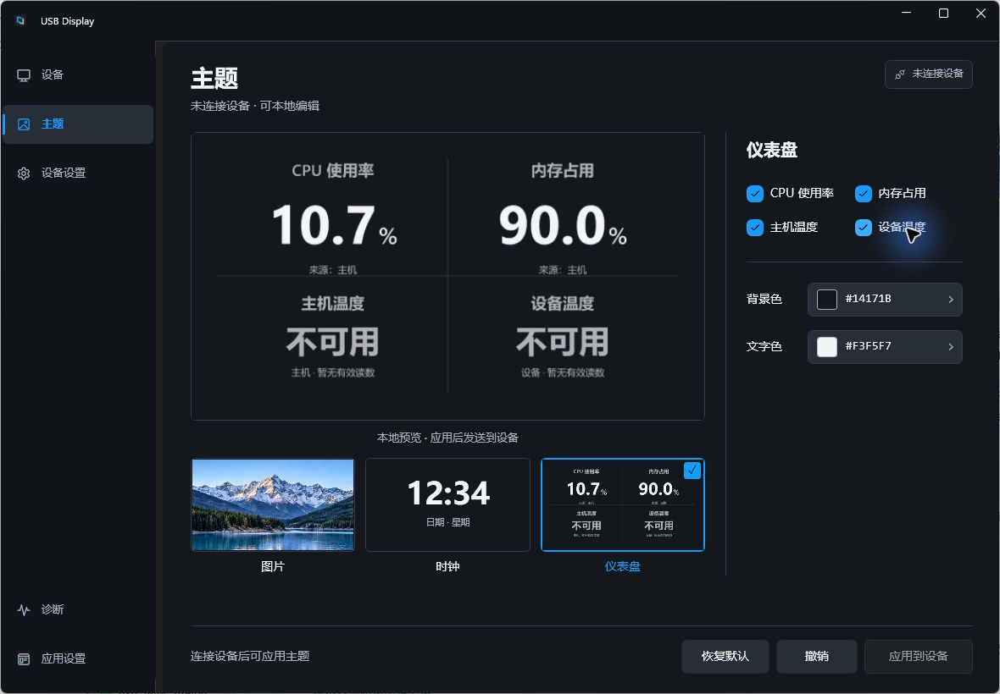

# 主题页默认窗口运行核对

2026-10-30 在 Windows 实际 WPF 窗口以 `--ui-only` 核对，窗口截图为 1180 × 820。本次发布复用同日主题页调试的运行证据，未重复启动应用；对应主题代码已提交至 `290de4d`，随后无冲突合入 0.1.3 修复。

三种模板切换、颜色展开与键盘收起、撤销已运行核对。图片为最终布局截图；时钟和仪表盘截图早于顶部异常提示防重叠的保护条件修改，该条件已编译和静态复核，未实际触发异常场景。无设备运行不代表真实设备显示、安装升级或其他窗口尺寸与 DPI 验收。

## 图片

## 时钟

## 仪表盘

