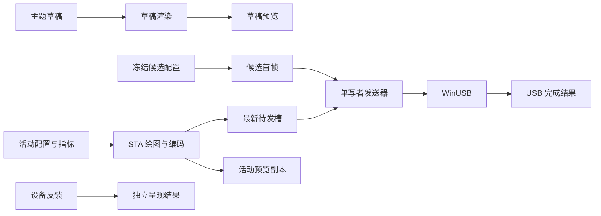

# USB Display 上位机首版技术设计

## Context

动机与范围见 [proposal.md](proposal.md)。2026-10-07 仓库检查结果：只有 README、六份 v0.5 设计文档、两份参考资料和初始化后的 OpenSpec；没有解决方案、应用源码、测试工程、固件源码、驱动包或样机记录。本文描述计划结构，不能作为已实现或已验证的证明。

以 [软件技术架构](../../../docs/03_软件技术架构.md) 为技术基线，以 [PRD](../../../docs/02_PRD.md) 为行为基线，以 [项目规范](../../../docs/05_项目规范.md) 的 TC-01～TC-38 为验证依据。原始资料中的 CDC 默认形态、分辨率、分片示例、HID 报告长度及复位语义存在已登记冲突，采用需求分析 Q-01～Q-16 的处理规则。

## Goals / Non-Goals

**Goals:**

- 让设备用例、协议和配置规则可以脱离硬件测试，同时保留驱动、真实显示和安装更新的独立验收关口。
- 确定唯一的状态写入者、帧与原生 I/O 资源所有者，保证拔插、迟到结果和部分写不会污染新会话。
- 使 UI、内容管线和更新生命周期互不阻塞，应用结果能够分别说明发送、保存与设备反馈。
- 在原有四工程边界内完成 V1，建立可重现构建、故障定位和跨版本修复路径。

**Non-Goals:**

- 不在本仓库设计或实现厂商显示驱动、固件数据解析器；协作方的交付物作为主机集成输入。
- 不引入通用插件框架、独立业务后端、数据库或常驻特权服务；不提前拆分通信／渲染进程。
- 不把 HID 草案字节、示例 VID/PID 或未经验证的编码参数固定成量产协议；未冻结输入只允许模拟开发。

## Decisions

### D1. 四工程模块化单体与显式组合根

| 计划工程 | 目标框架 | 所有权与边界 |
|---|---|---|
| `src/UsbDisplayHost.Core` | net10.0 | Devices、Sessions、Themes、Protocol、Configuration；用例、不可变快照、接口及纯规则 |
| `src/UsbDisplayHost.Windows` | net10.0-windows | SetupAPI、WinUSB、HID、原生资源、指标、文件存储、日志和更新 SDK 适配 |
| `src/UsbDisplayHost.Rendering` | net10.0-windows＋WPF | 专用 STA 的离屏绘图、图片读取与 JPEG 编码 |
| `src/UsbDisplayHost.Desktop` | net10.0-windows＋WPF | WPF UI Shell、MVVM、桌面服务、NotifyIcon、预览适配和组合根 |

Desktop 引用其余三项；Windows／Rendering 只向 Core 依赖；Core 不引用 WPF 类型或原生句柄。四个对应 MSTest 工程分别覆盖纯逻辑、Windows 适配、渲染及 ViewModel。WPF-UI 与 CommunityToolkit.Mvvm 仅进 Desktop，Serilog 实现在适配侧，Core 仅用日志抽象。

建项交付 `global.json`、集中包版本、锁文件和本地统一构建入口，启用 nullable、分析器、锁定还原。计划发布 win-x64 自包含包，不默认裁剪或 AOT。版本补丁与 Windows 11 build 通过 T-07／G0 验证后锁定。

取舍：把全部代码放进桌面工程会破坏离线测试与硬件隔离；按每个类拆程序集或预建插件层增加首版维护成本。当前采用四个可检查的编译边界，未来只在证据显示崩溃隔离或权限需求时调整进程边界。

### D2. 以冻结的兼容记录接入设备

G0 计划形成 `docs/contracts/device-baseline.md`、`data-plane.md`、`hid-control.md`，分别登记硬件／驱动、数据面、控制面契约；这些文件尚未存在，由任务 1.x 创建。每份记录包含来源、确认人、版本、未决项及抓包／实机证据引用。

目标设备组合沿用 VID 0xA108、主题 PID 0xADA0、副屏 PID 0xAD11 的设计值，实际匹配表须由描述符冻结。AD10／CDC 只可进入明确标记的研发兼容记录，不能静默混入正式双模兼容表。端点、接口号、包长和 HID 报告长度从当前设备读取；不猜测报告 ID、0x30+ 命令或 request type。

启动先订阅 PnP 再枚举，通过接口路径去重。序列号优先作为跨重枚举身份，容器与位置仅作辅助；重复身份或歧义必须停止自动接管。副屏态只连接合法控制面，不占用厂商显示数据面。

取舍：直接照抄参考代码能够更快获得实验发送器，但会带入已知分片错误和未确认控制语义。采用明确契约及能力白名单，允许先完成 UI 与模拟用例，实机接入按输入逐项放行。

### D3. 单写者状态与有界资源所有权

DeviceCoordinator 串行受理连接、应用、亮度、电源、切换、恢复和关闭；它只负责调度，不兼任渲染器、存储器或分片器。连接、设备模式、电源、推流为独立状态维度；对外快照带单调版本。状态查询默认 1Hz，超时和帧龄使用注入的单调时钟。

所有异步完成携带会话代次与操作号；主题帧增加内容修订号和帧号。设备离开立即使旧代次失效。重连不能让旧 ACK、渲染或保存完成覆盖新设备；同一会话换主题不能让旧修订覆盖新内容。保存操作须绑定设备键与受理修订，不能以“当前选中设备”作为迟到回调的写入目标。

| 通道 | 上限与处置 |
|---|---|
| Bulk | 一个在途帧＋一个可替换的最新待发帧；当前帧分片完整结束后才插入命令 |
| 渲染 | 一个执行中请求；活动与草稿各一个可替换待处理请求；活动优先 |
| 预览 | 一个解码中副本＋一个最新待处理副本；UI 最多一个待处理更新 |
| HID | 一个写执行者，独立读循环；重要控制不丢弃，未发送亮度目标可合并 |
| 事件 | 生命周期与已受理操作完成可靠交付；采样和重复通知合并，回调不阻塞系统线程 |

WinUSB／HID 使用 overlapped I/O，覆盖同步完成、pending、失败和取消竞态；每个请求拥有缓冲和完成状态，只结算一次。取消或托管超时后继续等待内核完成，随后才释放；不能通过丢弃 Task 结束资源所有权。

取舍：锁住 UI 或将每个回调直接 Task.Run 都不能表达设备顺序及资源上限。事件循环只发起异步操作、接收完成事件，离线与关闭事件始终可处理。

### D4. 整帧 JPEG 和保留最新内容的发送链路

DrawingVisual／RenderTargetBitmap 按物理像素、96 DPI 离屏生成；不依赖管理窗口 Visual 树。0／180° 使用 W×H 逻辑画布，90／270° 使用 H×W，最终输出仍为 W×H。JpegBitmapEncoder 先经 T-06 检验 SOF、采样、尺寸、中文及真机解码；失败只替换问题渲染或编码适配器，不维护两条正式管线。

单帧上限为 `min(1,048,576, 已验证固件上限)` 字节。质量默认 80，可设 70～85；从所选值按 5 下降且最后尝试 70，去除重复值，每帧最多 4 次。仍超限则报错，不能截断 JPEG 或私自缩小协议分辨率。

分片限额 `T=min(245760, 已验证固件 max_transfer, WinUSB 最大传输长度)`，要求 T>11。剩余长度≤T-11 时使用唯一尾片 0x69／11 字节头；否则使用 0x68／8 字节头，payload=`min(T-8, remaining-1)`，为尾片保留至少 1 字节。offset 与 size 使用 24 位大端，全帧 pixel_offset=0。算法边界使用任意字节测试，完整发送入口另验真实 JPEG；不能把 1 字节边界样本当合法图片。

亮屏握手依冻结契约发送 COLOR_FORMAT、宽高、BACKLIGHT、AUTORLX=0、MJPEG=1、BLANK_MODE=ON，任一步失败不发图。Off 意图建立控制会话时跳过会点亮屏幕的序列，等待明确唤醒操作。ZLP／SHORT_PACKET_TERMINATE 仅按实际包长和经验证的设备配置启用，不填充未定义字节。

静态内容按变化发送，时钟和指标 1Hz 更新，上限默认 5fps。持续延迟但无协议错误时逐步降到最低 1fps；稳定 30 秒后允许恢复至用户上限，具体阈值在 M2 测量冻结。超时、短写、取消立即停止该帧，收敛 I/O 后最多一次自动恢复；没有可靠 parser 清理方式则停止并提示重新插拔。ResetPipe 不代表固件拼帧状态已清除。

取舍：首版整帧 JPEG 更易验证；rlx 局部刷新不进入本发送器。无限队列或失败分片重试会积压旧内容并放大协议不确定性，因此只替换尚未发送的旧帧。

### D5. 草稿、活动配置、恢复配置与反馈分离

ThemeDraft 保存编辑修订；ActiveProfile 是当前会话后续产帧依据；DeviceProfile 是重连／重启恢复依据；DeviceSnapshot 记录观察到的实际状态。主题应用只提交主题字段，设备设置应用只提交方向／画质／帧率，均与受理时其他已生效字段合并。即时亮度确认和保存走同一协调器，避免旧表单覆盖新字段。

应用事务：冻结草稿和操作号 → 验证素材并准备合法首帧 → 再次核对会话 → 完整帧边界切换候选 → 首帧不可被普通刷新替换 → USB 完整完成后更新 ActiveProfile → 原子保存 DeviceProfile。每阶段独立结果如下。

| 结果 | 会话与恢复行为 |
|---|---|
| 候选校验失败 | 原活动主题继续，旧恢复配置及草稿保留 |
| 首帧部分写／未知 | 停流及恢复，旧恢复配置保留，不声称旧画面已还原 |
| USB 完成、保存失败 | 会话继续候选；重连仍用旧恢复配置；“重试保存”仅写本地 |
| USB 与保存完成、呈现未知 | 保存新值，显示“已发送，已保存”，不显示“设备已显示” |

应用期间的新编辑形成另一草稿，旧操作不能清除其未应用标记。同会话暂停／唤醒使用 ActiveProfile；重连／重启使用 DeviceProfile。没有设备、副屏、暂停或熄屏时只能保存草稿。无设备草稿与各设备草稿隔离，选择设备不能自动覆盖恢复配置。

文件置于 `%LocalAppData%/UsbDisplayHost.Data`，与安装和更新缓存分离；schemaVersion、临时文件替换、备份和损坏副本保护恢复路径。用户图片复制进素材目录；20MiB 文件及 2000 万像素限制在分配前验证，合成透明背景并处理方向元数据。草稿、活动、恢复配置与在途应用引用的素材均不可清理。

取舍：一个双向绑定的“当前设置”无法区分本地编辑与设备结果，也无法说明保存失败后的重连行为，因此采用显式配置分层。

### D6. HID 双模控制以观察到的结果完成

HID 契约须包含 collection、报告长度／ID、能力版本、操作关联、受理／完成、错误、重复语义及超时查询；HidP_GetCaps 返回当前长度，不能固定 64／65 字节。无能力或未知固件拒绝扩展命令。

主题→副屏：停止产帧 → 完整结束或取消并收敛在途写 → 释放主题数据面 → 通过有效 HID 切换 → 等重枚举 → 关联同设备、重开 HID、核验显示驱动及系统显示路径。副屏→主题：HID 切换 → 目标枚举 → 重新核验并打开接口 → 按电源意图初始化；亮屏且允许推流时发送合法首帧，Off 时保持控制就绪与停流。

切换等待目标 8 秒；超时或 ACK 丢失后重新枚举和查询。目标实际可用则成功，原态可用则切换未完成，无法核实则结果未知；不自动往返补偿。模式与电源独立，纯熄屏必须使用已确认的不复位控制，严禁用 BLANK_MODE=0x02 替代。

亮度 0～100 即时调整，合并尚未发送值且保证最终值执行，区分请求、读回与待确认；只有确认后保存意图。副屏亮度／熄屏按冻结的适用模式限制，能力限制不得掩盖 V1 双模和主题态纯熄屏的缺失。

取舍：以 ACK、写完成或 PID 出现即报切换成功无法证明可操作性；目标态核验增加等待，但能给出可追踪的结果。

### D7. 原生工作区只投影用例状态

Desktop 采用 FluentWindow／TitleBar、NavigationView、NumberBox、ContentDialog、Snackbar；具体 API 与资源映射按锁定版本验证。DeviceStatus、ContentPreview、InlineMessage 组合业务展示。MVVM 只依赖 Core 用例、快照和桌面服务，不接收原生适配器。

五页平级导航，缓存限定五页；草稿独立于页面缓存，切页显式管理订阅。隐藏窗口停发预览通知，设备管线继续；恢复窗口读取最新快照。首页只读活动或已标记的历史预览，主题页只读当前草稿，预览缓冲独立持有，不等待 UI 消费再发送。

视觉资源严格取自 [UI 设计规范](../../../docs/06_UI设计规范.md)：浅色主题、高对比度动态切换，默认 1180×760 DIP，支持 800×600 和 640×400，<800 DIP 折叠导航，预览保持 9:20 物理比例。PerMonitorV2、键盘、读屏器、文字放大及焦点回归均使用实际窗口验证，不以缩放截图代替。

取舍：管理窗口截图无法稳定生成设备画面，且受导航、DPI 与最小化影响；独立内容模型与预览副本保持输出稳定。

### D8. 应用生命周期与诊断具备单一所有者

ApplicationLifetime 持有发现、会话、渲染、指标、托盘、日志和更新服务。显式 STA 入口先处理更新 hooks，再建立同用户会话单实例锁；二次启动只唤起原窗口。OnExplicitShutdown 区分关闭至托盘与显式退出，关闭默认收托盘，自启与启动自动切主题默认关闭。

退出按停止受理→停产帧→原生 I/O 收敛→停 HID→释放句柄／渲染→释放托盘与刷新日志的顺序执行。退出切副屏为能力允许时的可选策略；失败保留结果供继续退出／重试，系统关机采用有界清理而不弹阻塞对话框。

PC CPU／内存使用基础系统接口；温度适配隔离，缺失不提权主进程。指标包含来源、单位和采样时间，3 秒过期。generated、hostDropped、usbCompleted、deviceDecoded、devicePresented 分开统计，无设备反馈则留空。日志按 10MiB×5 滚动且异步队列有界，轮转时总量也须验证；诊断事件列表最多 500 条，导出不含用户图片、个人完整路径或凭据。

取舍：窗口／页面拥有会话会使导航或托盘行为干扰设备；集中生命周期使清理及更新交接可验证，底层细节仍由各模块负责。

### D9. 安装更新沿用显式交接而非隐式升级

Windows 适配 Velopack，Core 暴露应用更新用例与独立快照；T-31 锁定 SDK／工具、packId、稳定通道、实际 HTTPS 源、签名和兼容策略。仅完整包，SemVer 比较，只推荐同产品、架构及 OS 兼容的更高稳定版。更新源不得使用演示地址。

自动检查默认开启，自动尝试至少间隔 24 小时，手动绕过间隔但不并发。检查不自动下载，下载不自动安装；下载可取消且不阻塞推流。记录真实字节进度，空间、包大小、哈希、TLS 和兼容性异常分别报告；哈希不等同发布者签名。关闭启动自动安装，确保“稍后”、普通退出和再次启动不会隐式安装。

“重启并安装”先固定并再次验证包、处理未保存设置、保存草稿，再进入 UpdateRestart：拒绝新设备写、收敛在途操作、释放资源和刷新日志，全部完成才交给辅助程序。失败保留当前进程和错误，可重新连接。更新重启跳过退出切副屏和启动自动切主题，沿用电源意图；目标版本、配置和窗口／托盘初始化成功后才记录“已更新”，不要求设备在线。

发布时对应用及自有辅助程序、Setup／Update 产物签名验签，先上传完整不可变版本包再更新索引。使用真实安装的两个版本验收迁移；失败提供签名完整包修复及日志入口，不把 SDK 行为推定为健康自动回滚。

取舍：手写替换 EXE 或退出后暗中安装难以处理设备在途写、占用文件和用户决定；采用既定更新引擎并由生命周期控制交接。

## Risks / Trade-offs

- [样机描述符与 2400 高解码不一致] → T-02／T-04／T-06 检查全接收、缓冲、解码和 DPU 路径；未通过时不放行真实推流。
- [HID 草案、纯熄屏或恢复能力未交付] → T-05／T-21 外部交付及实测是 M4 入口；模拟不能关闭这些任务或降低 V1 标准。
- [取消后内核仍持有缓冲] → 原生请求所有权延续至完成通知；以取消／完成竞态与句柄计数验证。
- [系统 JPEG 不满足固件采样／性能] → T-06 先做小实验，记录失败样本，仅替换问题适配器后重验。
- [WPF UI 在紧凑布局、焦点或高对比度存在差异] → T-07／T-29 验证真实锁定版本，沿用库控件并做必要局部适配，TC-29／TC-30 验收。
- [驱动授权、签名或更新源未落实] → G0 即验证干净机及分发条件，M5 单独记录缺失输入，不以本地运行代替正式交付。
- [资源预算或工期粗估不足] → 固定参考机冻结 CPU／内存预算，并重估 UI、更新和测试人日；保留性能原始样本与硬件等待成本。

## Migration Plan

这是首次建项，无既有应用数据库迁移。后续版本需对 schemaVersion 做可备份、可失败的迁移；不改写原始参考资料，不借本变更更新固件或替换共享驱动。

| 阶段 | 实施入口与放行证据 |
|---|---|
| G0 | 冻结范围、责任、工具、数据面与环境；工程、纯逻辑和无设备 UI 可先行，真实通信须满足对应契约 |
| M1 | 命令／分片、设备发现、握手、静态图；真实 1080×2400 图与单／多片及短包证据 |
| M2 | 单写者、取消、部分写、拔插、休眠；故障注入与真实恢复记录 |
| M3／V0 | 三模板、配置应用、五页主题范围、指标、托盘、诊断；TC-01～TC-19、TC-26～TC-33 的主题范围及至少 1h 稳定性 |
| M4 | 匹配固件到位后验收两态 HID、双向切换、纯熄屏；TC-20～TC-23 |
| M5／V1 | 安装更新及全部适用 TC-01～TC-38、24h 长稳、50 次拔插、20 次休眠、双方向各 50 次切换；最终包复验并发布归档 |

回退应用前检查旧版可读 schema，保留原配置、素材和迁移备份；使用已签名完整包修复，软件回退与配置恢复分别验收。公开发布和硬件联调按任务执行时提供的真实环境开展，本次仅产出规划工件。

## Open Questions

以下参数由已指定任务采集，不改变现有产品范围或模块拆分：SDK／依赖补丁版本和 Windows build（T-07／T-02）、参考 PC 与资源预算（T-06）、延迟降速阈值（T-12）、packId／域名／签名责任人（T-31）。任何采集结果若要求改变分辨率、双模、纯熄屏或 V1 验收标准，须另行评审并同步 REQ／FR／TC；不能在实现时自行降级。
